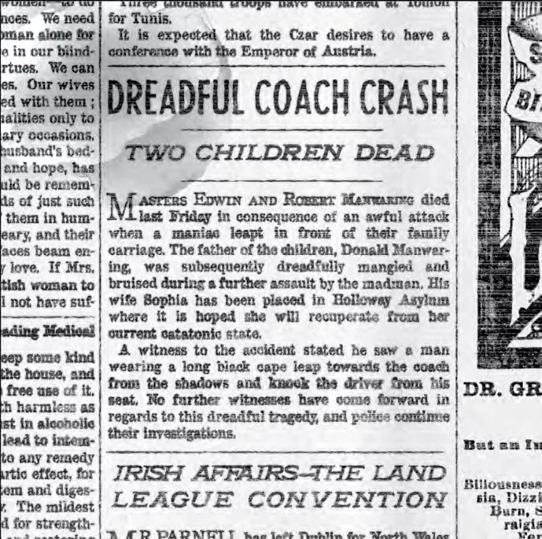

> **Раздатка 4**
>
> **УЖАСНОЕ КРУШЕНИЕ КАРЕТЫ**
>
> **ДВОЕ ДЕТЕЙ ПОГИБЛИ**
>
> ЮНЫЕ ЭДВИН И РОБЕРТ МЭНУОРИНГ погибли в прошлую пятницу после жуткого нападения: маньяк прыгнул прямо перед их семейным экипажем. Отец детей, Дональд Мэнуоринг, затем был страшно изувечен и избит при новом нападении безумца. Его жена София помещена в Холлоуэйскую лечебницу, где, как надеются, она оправится от нынешнего кататонического состояния.
>
> Свидетель происшествия заявил, что видел, как человек в длинном чёрном плаще выскочил из тени к карете и сбил кучера с козел. Других свидетелей этой ужасной трагедии не нашлось, полиция продолжает расследование.

*По краям вырезки — обрывки соседних колонок газеты: «Три тысячи солдат отплыли из Тулона в Тунис», «Ожидается, что царь желает встретиться с императором Австрии», заголовок «Ирландские дела — съезд Земельной лиги», рекламные строки («Д-р Гр…», «…от разлития желчи…») и конец чьего-то письма о жёнах и домашних добродетелях.*

## Ловушка

Хранителю стоит сделать эту сцену как можно атмосфернее: унылые заснеженные улицы, неестественная тишина, снег словно светится, отражая ночное небо. Какое-то время ничего не происходит, кроме возможных случайных встреч или встреч с полицией. Сразу после полуночи раздаётся пронзительный крик. Это происходит возле Уиллоу-роуд. Если сыщики уже там, выберите другое место. Благодаря тонкому слуху и знанию района команда Петерсона быстро доберётся до места. Другой команде, если только сыщик не знает район или они уже не рядом, придётся идти на звук.

Добравшись до перекрёстка Уиллоу-роуд и Пилгримс-лейн, команда видит распростёртую на улице фигуру в чёрном. Петерсон узнаёт в ней Мейзи, одну из приманок, и удивляется, почему она не засвистела, зовя на помощь.

**Заметка для Хранителя:** *если сыщик пройдёт чрезвычайную проверку* **Внимания**, *он заметит, что с телом что-то не так: очертания чуть-чуть не те, или там блеснул металл.*

Если первой туда доберётся команда Годфри, он бросится на помощь Мейзи, иначе — Ходжес. Когда кто-то подходит к ней, фигура вскакивает: это Джек-Прыгун в своём просторном чёрном плаще. Его белое измождённое лицо злобно ухмыляется команде, и, громко хихикая, он нападает. Джек-Прыгун будет драться, пока его не ранят, а затем, хихикая, прыжками умчится в сторону Хэмпстед-Хита.

У сыщиков будет мало времени, чтобы прийти в себя и перевязать раны. Как только появится Мэнуоринг (если его ещё нет на месте), он бросится в погоню за Джеком. Остановить его в этой погоне могут лишь тяжёлое ранение или смерть; он и слышать не захочет об отдыхе, даже если кто-то из его товарищей пал.

## Хэмпстед-Хит

Обе команды, теперь объединившиеся в одну, должны направиться к Хэмпстед-Хиту. Сыщик, прошедший проверку **Чтения следов**, найдёт на снегу капли крови Джека. Идя по ним, каждые двадцать метров они будут натыкаться на глубокие следы там, где он приземлился.

Добравшись до ограды вокруг Хэмпстед-Хита, команда может либо открыть замок на одних из ворот (трудная проверка **Взлома**), либо пройти проверку **Лазания** и перебраться через ворота и ограду. Дальше команда может идти по следу через Хэмпстед-Хит.

Пустошь велика, на ней много деревьев и холмов, и всё покрыто нетронутым снегом. Джек не возвращается сразу в своё укрытие (см. **Заброшенный лодочный сарай** ниже): он намерен убить ещё несколько человек. Поэтому он попытается устроить им засаду на пустоши.

От края пустоши до пруда и заброшенного лодочного сарая — примерно семьсот пятьдесят метров. След похож на тот, что был на улицах, но Джек движется по снегу зигзагом. Как и прежде, пусть сыщики проходят проверку **Чтения следов**, чтобы найти кровь и отпечатки.

Прежде чем вернуться в своё убежище, Джек трижды попытается устроить команде засаду. На полпути к пруду местность сменяется лесом. Один раз он нападёт прежде, чем команда дойдёт до опушки: он поджидает там с тех пор, как пришёл на Хэмпстед-Хит. Ещё дважды он нападёт в лесу.

**Заметка для Хранителя:** *постарайтесь, чтобы нападения были как можно внезапнее и неожиданнее. На открытом месте Джек вырвется из-под снега; Хранитель помещает его где хочет, лишь бы рядом с сыщиками, идущими по его следу. Чрезвычайная проверка* **Внимания** *выдаст, где он. Во время первой засады в лесу он спрыгнет с дерева, и сыщикам понадобится чрезвычайная проверка* **Слуха**, *чтобы расслышать, как он прячется. Во время последней засады они наверняка будут смотреть на деревья, а Джек на самом деле затаится под снегом и подлеском.*
