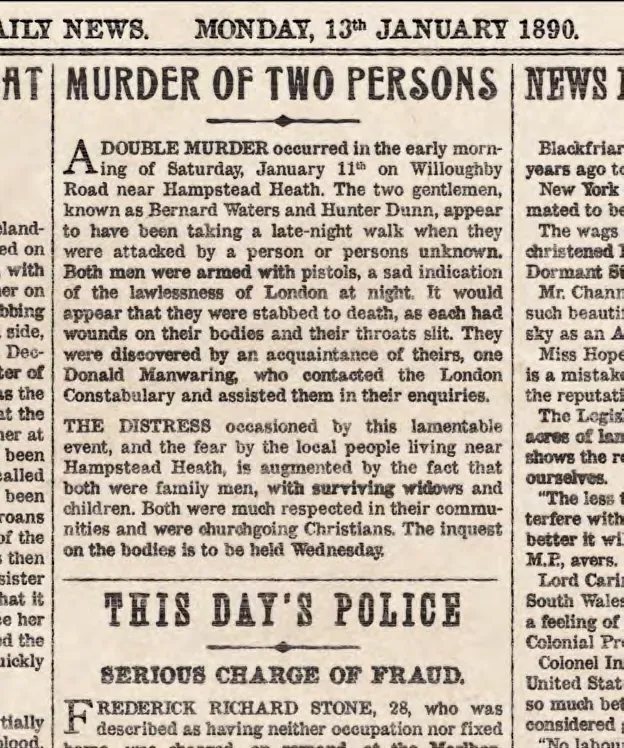

# Заброшенный лодочный сарай и развязка

## Заброшенный лодочный сарай

Лодочный сарай стоит на берегу стоячего пруда; он сложен из кирпича, крыша двускатная, из шифера. Кирпичи старые, в пятнах, на крыше не хватает плиток. К западу от сарая (если считать, что дверь смотрит на юг) лежат две гребные лодки — сгнившие, наполовину залитые водой. В одной из лодок — бухта верёвки длиной двадцать метров, старой, но ещё годной. В крыше сарая большая дыра, но с земли её не видно. Дверь в сарай со стороны берега заложена кирпичом.

Если сыщики преследовали Джека достаточно быстро, они увидят, как он приземляется на крышу и исчезает. Команде придётся выбирать: лезть на крышу или идти вброд через пруд, чтобы попытаться попасть внутрь через проток.

Стены высокие, лезть будет трудно. Если товарищ подсадит, сыщик может забраться на крышу сбоку, пройдя трудную проверку **Лазания**. При провале он падает и получает 1d2 урона, если только не пройдёт проверку **Прыжков**.

Если сыщики войдут в холодную стоячую воду, путь им преградят большие деревянные ворота. Они заперты изнутри, а из-за того, как они стоят в воде, и из-за их размера снаружи через них совершенно не пробиться.

Забравшись на крышу, сыщик замечает большую дыру на середине западного ската. Каждый, кто пытается пройти по крыше, должен пройти проверку **Удачи**: крыша чрезвычайно хрупкая. При провале он проваливается сквозь крышу внутрь сарая и получает 2d6 урона (1d2, если пройдёт проверку **Прыжков**).

От дыры в крыше до пола сарая — два метра. Если сыщик повиснет на руках и спрыгнет, чтобы приземлиться благополучно, нужна проверка **Прыжков**, иначе он получит 1d2 урона от падения.

Если Мэнуоринг ещё жив и в силах, он будет настаивать, чтобы войти в сарай первым.

Внутри сарая темно, так что сыщикам придётся позаботиться о собственном освещении. Северная половина залита водой, в южной — гнилое дерево. Джек-Прыгун вырыл нору в юго-западном углу; там его и найдут — свернувшимся, как личинка, на глубине метра, усталым и готовым впасть в спячку. Вокруг ямы — кучки земли вперемешку с древесной щепой. Того, кому хватит глупости полезть в нору, Джек атакует и в тесноте, скорее всего, убьёт. Однако Джек — лёгкая мишень. Все члены клуба, кроме Мэнуоринга, предложат похоронить Джека там, где он лежит. Мэнуоринг попытается убить его и нападёт на любого, кто попытается ему помешать. Его придётся удерживать силой, а если рядом Рагхубир, тот придёт на помощь хозяину и будет драться, защищая его.

> **Раздатка 5**
>
> …ЙЛИ НЬЮС. ПОНЕДЕЛЬНИК, 13 ЯНВАРЯ 1890 ГОДА.
>
> **УБИЙСТВО ДВУХ ЧЕЛОВЕК**
>
> ДВОЙНОЕ УБИЙСТВО совершено ранним утром в субботу, 11 января, на Уиллоуби-роуд у Хэмпстед-Хита. Двое джентльменов, известных как Бернард Уотерс и Хантер Данн, по-видимому, совершали позднюю прогулку, когда на них напало неизвестное лицо или лица. Оба были вооружены пистолетами — печальное свидетельство беззакония ночного Лондона. Судя по всему, их закололи: у обоих раны на теле и перерезано горло. Тела обнаружил их знакомый, некто Дональд Мэнуоринг; он сообщил в лондонскую полицию и помогал ей в расследовании.
>
> СМЯТЕНИЕ, вызванное этим прискорбным событием, и страх жителей окрестностей Хэмпстед-Хита усугубляются тем, что оба были семейными людьми: остались вдовы и дети. Оба пользовались большим уважением в своих общинах и были набожными христианами. Дознание по телам назначено на среду.

*Ниже на вырезке — начало заметки «Полиция сегодня. Серьёзное обвинение в мошенничестве» («Фредерик Ричард Стоун, 28 лет, о котором сказано, что у него нет ни занятия, ни постоянного…»); по краям — обрывки соседних колонок (в том числе «Новости…», «Блэкфрайарс…», «Нью-Йорк…»).*

Если Мэнуоринга удержат, успешная проверка **Убеждения** или **Запугивания** заставит его признаться, почему он так себя ведёт. Он объясняет, что Джек-Прыгун — его дед, которого неведомые силы превратили в это существо. Он хочет убить его за то, что тот убил его детей и свёл с ума его жену.

Обыскав сарай, сыщики найдут два масляных фонаря, в каждом осталось немного масла, и груды книг, почти сгнивших в труху. Успешная проверка **Внимания** (возможна, только если есть свет) обнаружит среди гнилых книг потускневшие серебряные карманные часы. На крышке часов выгравировано: «Моему милому Джейкобу от любящей жены Мэри». Годфри или Ходжес узнают в них имена деда и бабушки Мэнуоринга.

## Развязка

Остальные члены клуба не знали о связи Джека-Прыгуна с Мэнуорингом — и уж точно не знали, что существо — его дед. После событий этой ночи Мэнуоринг или другие выжившие члены клуба распускают его. Если той ночью погибли все члены клуба, двое, что сейчас на северо-востоке, вернутся и закроют клуб. «Хадсону и Брэнду» предложат архив клуба: через неделю его доставят на Голден-сквер, 33, упакованным в шесть чайных ящиков.
