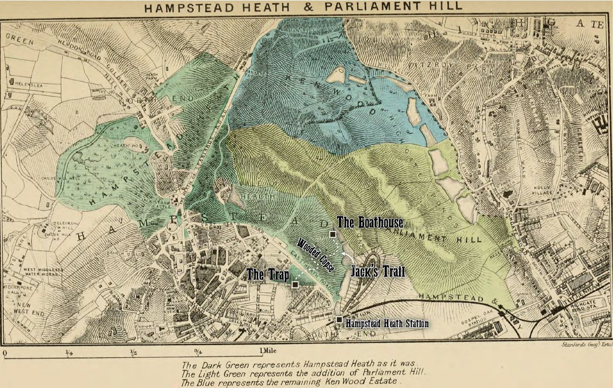

# Карта: Хэмпстед-Хит и Парламент-Хилл

*Заголовок карты: «Hampstead Heath & Parliament Hill» — «Хэмпстед-Хит и Парламент-Хилл». Основа — старинная гравированная карта (подпись «Stanford's Geog. Estab.» — Географическое заведение Стэнфорда); масштабная линейка — 0 – ¼ – ½ – ¾ – 1 миля (около 1,6 км).*

**Метки сценария**

| Метка на карте | Перевод |
|---|---|
| The Trap | Ловушка (перекрёсток Уиллоу-роуд и Пилгримс-лейн) |
| Wooded Copse | Лесистая роща |
| Jack’s Trail | След Джека |
| The Boathouse | (Заброшенный) лодочный сарай |
| Hampstead Heath Station | Станция «Хэмпстед-Хит» |

**Легенда**

- Тёмно-зелёным показан Хэмпстед-Хит, каким он был.
- Светло-зелёным — присоединённый к нему Парламент-Хилл.
- Голубым — оставшееся поместье Кенвуд.

*Прочие надписи старинной карты (Hampstead — Хэмпстед, Hampstead Heath — Хэмпстед-Хит, Parliament Hill — Парламент-Хилл, Ken Wood — Кенвуд, Highgate — Хайгейт, Highgate Ponds — Хайгейтские пруды, North End, South End, Vale of Health, New West End, Spaniards Road, East Heath Road, Highgate Road и др.) в сценарии не упоминаются.*
