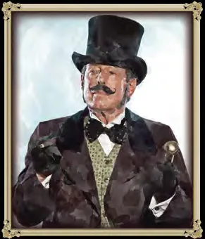
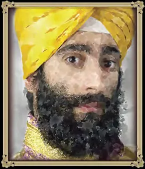
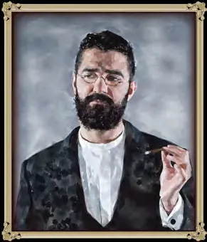
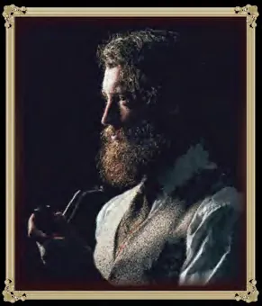

## Действующие лица

### Дональд Мэнуоринг — дилетант



Угрюмый, мрачно задумчивый человек; у Мэнуоринга были тёмные волосы и бакенбарды, на висках волосы преждевременно поседели. Он худощав, губы толстые, нос римский. Мэнуоринга преследуют прошлые трагедии, и его занимает только одно — оборвать жизнь своего заклятого врага. Ради этой цели он пожертвует кем угодно.

*Прим. перев.: на с. 4 у Мэнуоринга рыжие волосы, седеющие на висках; его сыновья на картине тоже рыжие.*

```stat
СИЛ 45    ВЫН 50    ТЕЛ 70    ИНТ 80    МОЩ 60
ЛВК 55    НАР 50    ОБР 70    Рассудок 60   ПЗ 12
БкУ: нет   Комплекция: 0   СКО: 6

АТАКИ
Ближний бой (драка) 25% (12/5), урон 1d3 + БкУ
Уклонение 27% (13/5)

Навыки: История 42%, Запугивание 46%, Иностранный язык (латынь) 33%, Работа в библиотеке 50%, Слух 50%, Оккультизм 30%, Психология 45%, Внимание 51%, Чтение следов 41%.
Возраст: 45
```

*Прим. перев.: в оригинале опечатка — «Fighting (Brawl) 25% (12/54)»; пятая часть от 25% — 5, исправлено.*

### Рагхубир — дворецкий



Рагхубир высок, носит тёмно-фиолетовый тюрбан, у него густая иссиня-чёрная борода с проседью. Он родом из Индии, по вере сикх, кожа у него тёмная, почти шоколадного цвета. У Рагхубира сильный, неторопливый голос с заметным акцентом. Он беззаветно предан своему хозяину и знает о его прошлом столкновении с Джеком-Прыгуном и о его цели — уничтожить Джека.

```stat
СИЛ 70    ВЫН 65    ТЕЛ 90    ИНТ 50    МОЩ 45
ЛВК 35    НАР 35    ОБР 54    Рассудок 45   ПЗ 15
БкУ: +1d4   Комплекция: 1   СКО: 6

АТАКИ
Ближний бой (драка) 75% (37/15), урон 1d3 + БкУ
Кукри 60% (30/12), урон 1d8 + БкУ
Уклонение 17% (8/3)

Навыки: Искусство/ремесло (служба дворецкого) 65%, Первая помощь 50%, Запугивание 50%, Слух 55%, Психология 40%, Ловкость рук 40%, Чтение следов 55%.
Возраст: 44
```

### Чарльз Годфри — врач



Годфри невысок и коренаст, это румяный человек с курчавыми чёрными волосами, лысеющий на макушке. Он очень жизнерадостен и видит в Призрачном клубе что-то вроде забавы: улыбается даже перед лицом нынешнего ужасного положения. Он родом из Эдинбурга и говорит с шотландским акцентом.

```stat
СИЛ 50    ВЫН 50    ТЕЛ 55    ИНТ 60    МОЩ 80
ЛВК 60    НАР 30    ОБР 73    Рассудок 80   ПЗ 10
БкУ: нет   Комплекция: 0   СКО: 6

АТАКИ
Ближний бой (драка) 25% (12/5), урон 1d3 + БкУ
Стрельба (револьвер «Вебли» MP .450) 60% (30/12), урон 1d10+1
Уклонение 30% (15/6)

Навыки: Наука (биология) 47%, Первая помощь 70%, История 41%, Работа в библиотеке 50%, Медицина 43%, Оккультизм 31%, Наука (фармакология) 58%, Внимание 40%.
Возраст: 56
```

### Уильям Ходжес — бухгалтер



Ходжес среднего роста и телосложения. У него короткие каштановые волосы и густая окладистая борода. Он тихий и склонен мрачно уходить в себя, но если к нему обратиться и заговорить, бывает вполне дружелюбен. Он всё ещё в шоке от гибели друзей, и его хрупкий рассудок это выдаёт.

*Прим. перев.: на с. 4 Ходжес — высокий.*

```stat
СИЛ 60    ВЫН 45    ТЕЛ 70    ИНТ 50    МОЩ 45
ЛВК 75    НАР 55    ОБР 75    Рассудок 22   ПЗ 13
БкУ: +1d4   Комплекция: 1   СКО: 8

АТАКИ
Ближний бой (драка) 25% (12/5), урон 1d3 + БкУ
Стрельба (револьвер «Вебли» No. 2 .380) 70% (35/14), урон 1d8+1
Уклонение 37% (18/7)

Навыки: Бухгалтерское дело 75%, История 55%, Юриспруденция 65%, Работа в библиотеке 60%, Оккультизм 35%, Убеждение 60%.
Возраст: 30
Фобии: гемофобия*

*Увидев кровь, Ходжес должен пройти проверку ВЫН, иначе он теряет сознание, пока его не приведут в чувство успешной проверкой Первой помощи. Если он потерял сознание, он также должен пройти проверку Рассудка, иначе теряет 1 очко Рассудка.
```

*Прим. перев.: ПЗ 13 — как в оригинале; по ВЫН 45 и ТЕЛ 70 выходит 11.*
