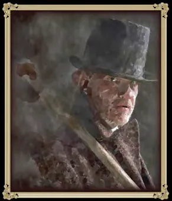
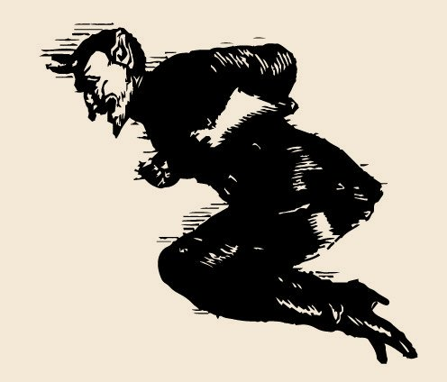
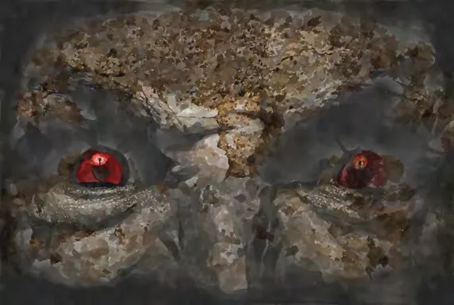

# Неигровые персонажи

### Петерсон — головорез



Петерсон — матёрый преступник и выглядит соответственно. Передних зубов у него нет, на бритой голове шрамы. Он говорит с сильным простонародным акцентом кокни, а из-за наполовину откушенного языка слегка шепелявит. Он предан клубу, вежлив и делает, что велят, пока ему платят. У него много связей в преступном мире: он может достать для работы клуба незаконные вещи, краденое и ещё преступников.

```stat
СИЛ 60    ВЫН 45    ТЕЛ 75    ИНТ 45    МОЩ 55
ЛВК 40    НАР 25    ОБР 29    Рассудок 55   ПЗ 12
БкУ: +1d4   Комплекция: 1   СКО: 6

АТАКИ
Ближний бой (драка) 50% (25/10), урон 1d3 + БкУ
Стрельба (револьвер «Вебли» WG .455) 50% (25/10), урон 1d10+2
Уклонение 20 (10/4)

Навыки: Оценка 30%, Первая помощь 35%, Запугивание 60%, Слух 75%, Убеждение 35%, Внимание 50%, Скрытность 45%.
Возраст: 54
```

*Прим. перев.: СКО 6 — как в оригинале; по характеристикам выходит 7, с поправкой на возраст 54 года — 5. «Уклонение 20» напечатано без знака процента.*

### Джек-Прыгун — чудовище



Ростом Джек почти семь футов (около 2,1 м), кожа у него бледная, черты лица заострённые, дьявольские. Глаза кроваво-красные, зубы металлические и острые. На нём металлическая шапочка и грязный чёрный плащ. Под плащом — облегающий белый костюм из промасленной ткани. Каждая из его длинных рук заканчивается стальной перчаткой-рукавицей с очень длинными когтями. Джек бос, пальцы ног у него длинные, ноги чрезвычайно мускулистые. Он безумно гогочет и хихикает и существует только ради проказ и бойни. Как он превратился из человека в это безумное существо — тайна, известная, возможно, только ему самому. Если осмотреть его тело после смерти, окажется, что оно странное, лоскутное — будто составлено из частей разных тел. После большого напряжения или потери пунктов здоровья Джек впадает в спячку, чтобы восстановить здоровье и силы.

```stat
СИЛ 150   ВЫН 80    ТЕЛ 100   ИНТ 30    МОЩ 120
ЛВК 160                                 ПЗ 23
Бонус к урону: +2d6
Комплекция: 3
СКО: 9/особая*
Пункты магии: 120

АТАКИ
Атак за раунд: 2
У Джека металлические когти, которыми он полосует. Он может бить ими дважды за раунд.
Ближний бой 80% (40/16), урон 2d6 + БкУ
*Прыжки 90% (45/18), урон 3d6
Уклонение 80% (40/16)

Броня: 4 очка крепкой плоти. Огнестрельное оружие наносит половину урона. Огонь и электричество наносят двойной урон.
Навыки: Внимание 60%, Скрытность 80%, Чтение следов 60%, Жуткое хихиканье 100%.
Потеря Рассудка: 1d6
Возраст: 99

*Джек обладает сверхъестественной способностью прыгать на большие расстояния. За один прыжок он пролетает двадцать метров (в высоту — не более десяти метров) и, если пройдёт проверку навыка, может приземлиться прямо на выбранную цель. Однако это дорого ему обходится: каждый прыжок стоит ему пяти пунктов магии и двух единиц ВЫН. Каждые двадцать четыре часа он восстанавливает пять пунктов магии и две единицы ВЫН.
```

*Прим. перев.: так в оригинале — ПМ 120 (обычно ПМ = МОЩ/5 = 24; возможно, так задумано, ведь каждый прыжок стоит 5 ПМ) и ПЗ 23 (по ВЫН 80 и ТЕЛ 100 выходит 18). Потеря Рассудка дана одним значением — 1d6 при провале проверки, без потери при успехе. У Джека нет НАР, ОБР и Рассудка.*


