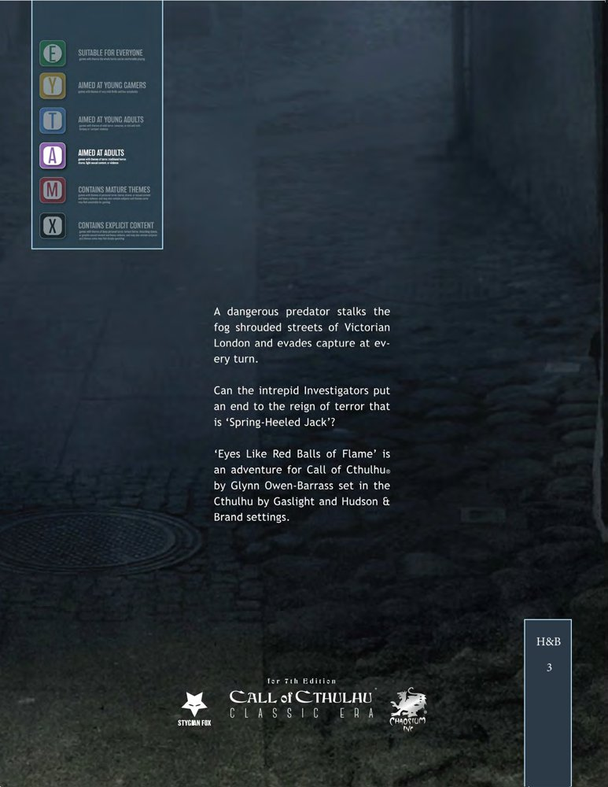

# Задняя обложка

Опасный хищник рыщет по окутанным туманом улицам викторианского Лондона и всякий раз ускользает от поимки.

Смогут ли отважные сыщики положить конец царству ужаса по имени «Джек-Прыгун»?

«Глаза как красные огненные шары» — приключение для «Зова Ктулху»® Глинна Оуэна-Барраса, действие которого происходит в мирах «Газового света» (Cthulhu by Gaslight) и «Хадсона и Брэнда».

*Слева вверху — шкала возрастной маркировки Stygian Fox (выделено «A»):*

| Знак | Значение |
|---|---|
| E | Подходит всем: игры с темами, в которые спокойно может играть вся семья |
| Y | Для юных игроков: игры с очень мягкими острыми ощущениями и несложными правилами |
| T | Для подростков: игры с лёгким ужасом, романтикой или риском и с фэнтезийным или «мультяшным» насилием |
| **A** | **Для взрослых: игры с ужасом, традиционным хоррором, драмой, лёгким сексуальным содержанием или насилием** — *эта книга* |
| M | Содержит зрелые темы: игры с личным ужасом, хоррором, драмой или сексуальным содержанием и сильным насилием; могут быть темы, которые кому-то покажутся неподходящими для игры |
| X | Содержит откровенный материал: игры с глубоким личным ужасом, хоррором пыток, тревожной драмой или откровенным сексуальным содержанием и сильным насилием; могут быть темы, которые кого-то глубоко расстроят |

*Внизу — логотипы Stygian Fox, «for 7th Edition Call of Cthulhu — Classic Era» («для 7-й редакции „Зова Ктулху“ — классическая эпоха») и Chaosium; на плашке справа — «H&B 3».*

*Прим. перев.: на передней обложке стоит «Gaslight Era» («эпоха „Газового света“»), на задней — «Classic Era» («классическая эпоха»); действие сценария — Лондон, январь 1890 года.*
