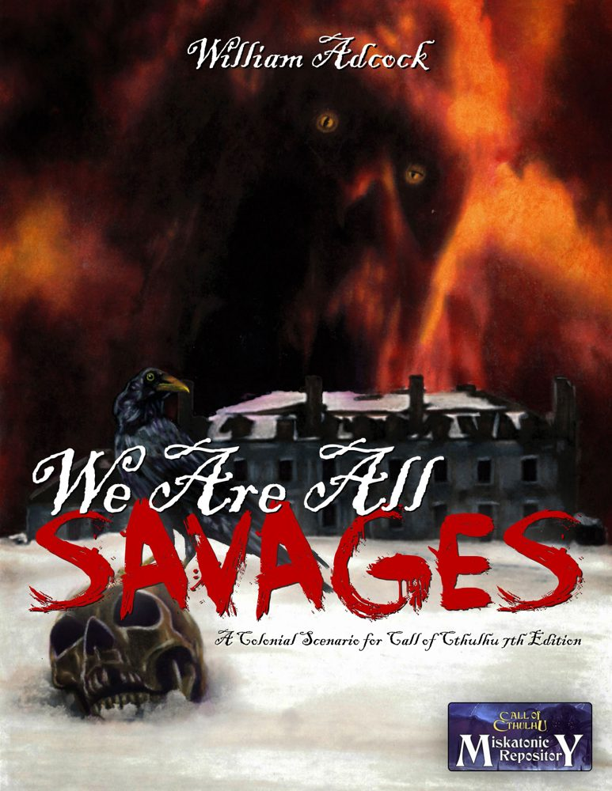

Уильям Эдкок

МЫ ВСЕ ДИКАРИ

Сценарий колониальной эпохи для «Зова Ктулху» 7-й редакции

*На обложке — заснеженный Французский замок, ворон и череп в снегу; над ними в огне и дыму проступает чудовищная фигура с горящими глазами. Вверху — имя автора (William Adcock), внизу — название «We Are All Savages», подзаголовок «A Colonial Scenario for Call of Cthulhu 7th Edition» и логотип «Call of Cthulhu — Miskatonic Repository».*
