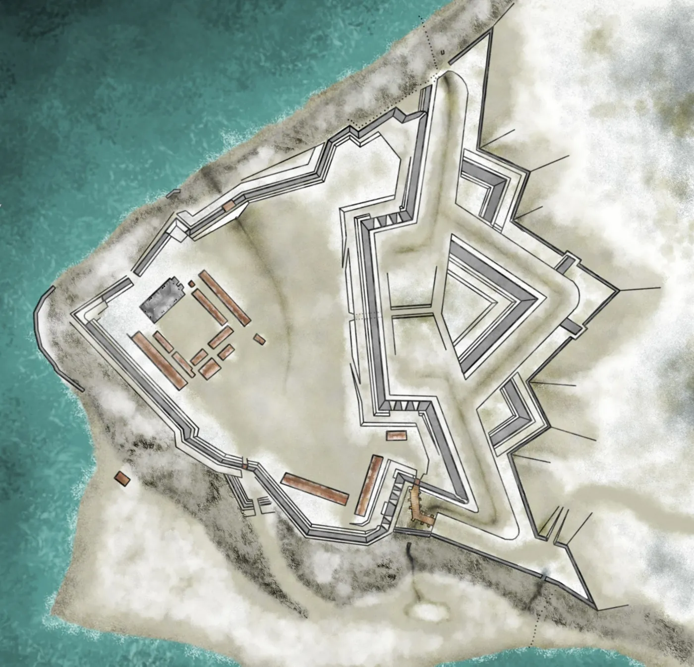

*Подпись под картой: «Карта форта Ниагара» (в оригинале — «Fort Niagra Map»).*

> ### Новое оружие: мушкет
>
> Игроков, привыкших палить из «томпсонов» в 1920-х, огнестрельное оружие 1760 года может потрясти. Всё огнестрельное оружие в этом сценарии — мушкет «Браун Бесс» длинного сухопутного образца: гладкоствольное дульнозарядное ружьё со стволом около 117 см и весом больше 4,5 кг. Полные характеристики оружия:
>
> | Название | Навык | Урон | Базовая дальность | Атак за раунд | Зарядов | Осечка |
> |---|---|---|---|---|---|---|
> | Мушкет «Браун Бесс» | Стрельба (винтовка/дробовик) | 1d8+4 | 40 м | 1/4 | 1 | 97 |

*Прим. перев.: в таблице оригинала навык мушкета — «Fighting (Rifle)» («Ближний бой (винтовка)»); листы сыщиков считают мушкет по навыку Стрельба (винтовка/дробовик) — так и в переводе.*
