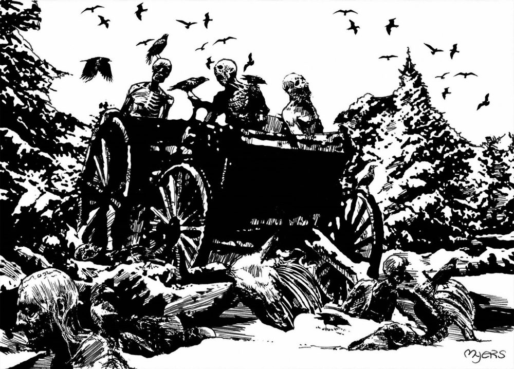

бочонки яблочного сидра, уксуса, патоки и сока лайма, а также ящики с корнеплодами и консервированными фруктами. Хотя остальное пытались уничтожить и испортить — картошку раздавили прикладами мушкетов или просто растоптали, ящики перевернули и вывалили в снег, — большую часть ещё можно спасти.

Сыщикам, которые захотят повернуть назад и доложить, что припасы уцелели, стоит напомнить, что это лишь половина задания: они должны найти лагерь налётчиков и принести сведения, с которыми подполковник Эйр сможет подготовить ответный удар. А если по пути удастся устроить небольшой переполох — тем лучше.

# По следу налётчиков

От места засады в лес на юге ведут тропы снегоступов; осмотрев эти следы, при успешной проверке **Внимания** сыщики заметят цепочку босых человеческих следов, петляющую среди следов снегоступов. Успешная проверка **Чтения следов** покажет, что расстояние между отпечатками необычно велико, словно оставивший их человек каким-то образом бежал по снегу, не проваливаясь. Некоторые из этих следов странно искажены — будто снег, в котором они отпечатались, немного подтаял, а потом снова замёрз; ни один след снегоступов ничего подобного не показывает.

В лесу выслеживать налётчиков по отпечаткам ног становится труднее, хотя они продолжают оставлять след, по которому можно идти: сломанные низкие ветки, плевки табачной жвачки на снегу, место, где человек остановился справить нужду у дерева, — всё указывает, откуда пришли эти люди. Чтобы дойти по следу до их лагеря, нужно в сумме три успешные проверки **Чтения следов**, **Внимания** или **Ориентирования** в любом сочетании. Под густыми деревьями снега на земле меньше, и сыщики смогут идти быстрее, сняв снегоступы, не рискуя провалиться или увязнуть.
