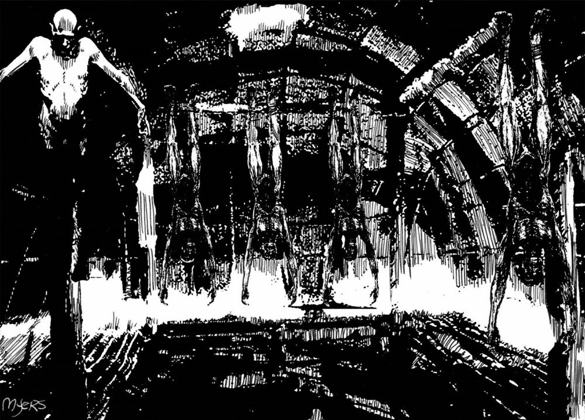

> *Он много где побывал и много чего видел — если правда хотя бы половина того, что он говорит. Прошлой ночью он рассказал алгонкинскую историю о голодном призраке, который является зимними ночами, и рассказал так хорошо, что половина людей не могла уснуть. В Кулоне есть сильное личное обаяние; мне это не нравится. Наш лагерь задумывался как лагерь равных, но люди всё чаще слушаются решений Кулона. Он предложил напасть на британский обоз, идущий к Ниагаре. Мне эта мысль не нравится: британцы страшно отомстят. Но людям мысль нравится, потому что её предложил Кулон.*
>
> *29 декабря 1759 года. Кулон становится невыносим. Он намекнул, что, пока жил у алгонкинов, их знахарь открыл ему древнюю мудрость и тайные магические уроки. Люди слушают как зачарованные. Он намекнул, что не может умереть и научит людей стать такими же. Этого я больше не вынесу.*
>
> *30 декабря 1759 года. Боже мой! Я оспорил заявления Кулона о бессмертии, и он потребовал, чтобы его испытали. По его же просьбе я выстрелил ему в грудь с двадцати шагов. Он пошатнулся, упал — и снова встал, а кровь уже перестала течь. Он лишь улыбнулся и попросил чистую рубашку. Что это за безумие?*
>
> *1 января 1760 года. Он открыл нам свою тайну и сказал, что теперь мы должны присоединиться к нему или умереть: только посвящённые могут жить с тем, что он нам поведал. Он людоед; человеческая плоть сделала его сильным и могучим, и он просит нас стать такими же, как он. Я тайком поговорил с некоторыми из людей. После набега на обоз, когда Кулон расслабится и ничего не будет подозревать, мы одолеем его и разрубим на куски, чтобы наверняка умер. А потом предадим себя в руки Господа Всемогущего.*

# Ледник

За длинным домом сыщики могут найти то, что осталось от недостающих французских трапперов. Двое мужчин зарыты в большой сугроб, наружу торчат только лица (к этому времени вороны почти обглодали их до костей). Снег под лицами порозовел от пролитой крови, и если их откопать,
