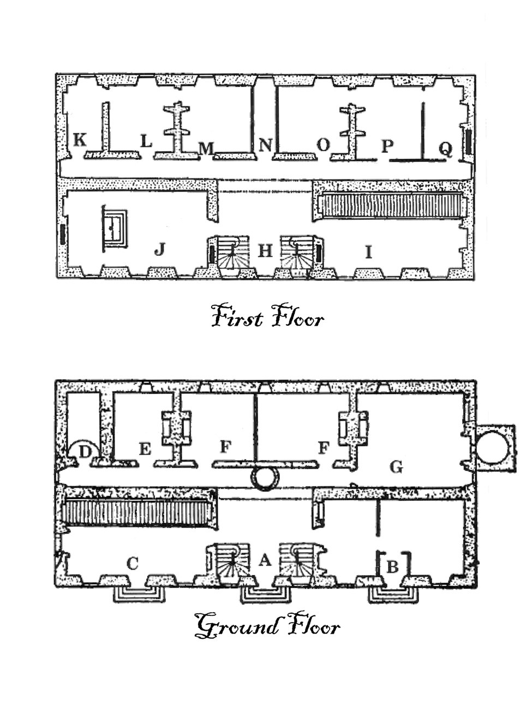

*Подписи на плане: «First Floor» — второй этаж (вверху), «Ground Floor» — первый этаж (внизу); подпись под планом — «French Castle Floorplan» («План Французского замка»).*

**Ключ** (описания комнат — в разделе «Во Французском замке», с. 12)

| Метка | Комната |
|---|---|
| **Первый этаж** | |
| A | Вестибюль |
| B | Торговая комната |
| C | Караульная первого этажа |
| D | Пороховой погреб |
| E | Кладовая |
| F | Зал Джонсона (на плане метка стоит дважды — две половины бывшей двойной кладовой, ныне одна комната) |
| G | Пекарня |
| **Второй этаж** | |
| H | Вестибюль второго этажа |
| I | Караульная второго этажа |
| J | Часовня |
| K | Кабинет |
| L | Покои коменданта |
| M | Офицерская столовая |
| N | Пост часового |
| O, P, Q | Офицерские комнаты |
| R | Чердак (верхний этаж; на плане не показан) |
