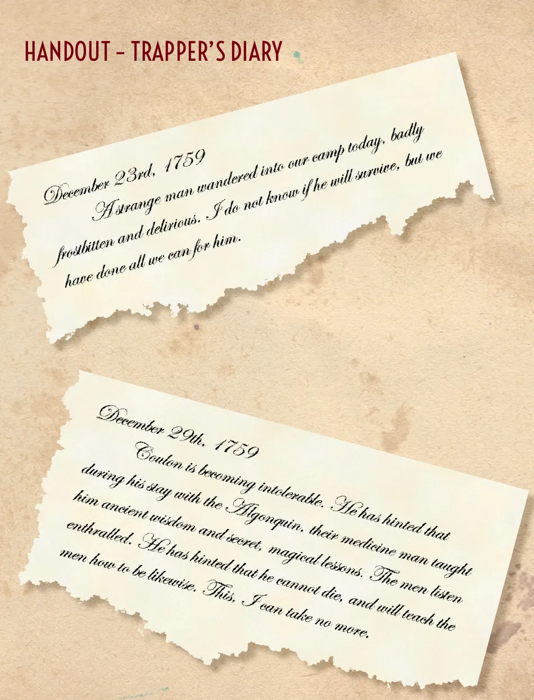

# Раздатка: дневник траппера

*Ниже — листы раздатки в оригинале (картинкой, для печати) и их перевод. В книге записи дневника написаны от руки по-английски на обрывках бумаги; по сюжету дневник ведётся по-французски.*

> **Раздатка «Дневник траппера» (лист 1)**
>
> *23 декабря 1759 года.*
>
> *Сегодня в наш лагерь забрёл странный человек, сильно обмороженный, в бреду. Не знаю, выживет ли он, но мы сделали для него всё, что могли.*

<!-- -->

> **Раздатка «Дневник траппера» (лист 1, второй обрывок)**
>
> *29 декабря 1759 года.*
>
> *Кулон становится невыносим. Он намекнул, что, пока жил у алгонкинов, их знахарь открыл ему древнюю мудрость и тайные магические уроки. Люди слушают как зачарованные. Он намекнул, что не может умереть и научит людей стать такими же. Этого я больше не вынесу.*
