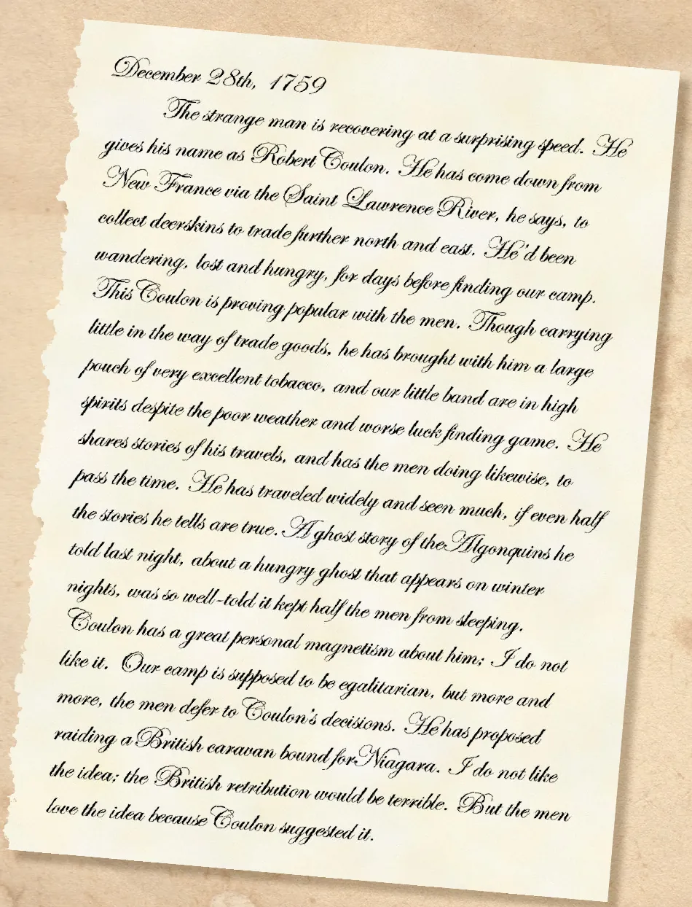

> **Раздатка «Дневник траппера» (лист 2)**
>
> *28 декабря 1759 года.*
>
> *Странный человек поправляется на удивление быстро. Назвался Робером Кулоном. Говорит, что пришёл из Новой Франции по реке Святого Лаврентия за оленьими шкурами, чтобы торговать ими дальше на севере и востоке. Прежде чем найти наш лагерь, он много дней блуждал, заблудившийся и голодный. Этот Кулон пришёлся людям по душе. Товаров для торговли при нём почти нет, зато он принёс большой кисет превосходного табака, и наша маленькая ватага в отличном настроении, несмотря на скверную погоду и ещё более скверную охоту. Чтобы скоротать время, он рассказывает о своих странствиях, и люди тоже рассказывают свои истории. Он много где побывал и много чего видел — если правда хотя бы половина того, что он говорит. Прошлой ночью он рассказал алгонкинскую историю о голодном призраке, который является зимними ночами, и рассказал так хорошо, что половина людей не могла уснуть. В Кулоне есть сильное личное обаяние; мне это не нравится. Наш лагерь задумывался как лагерь равных, но люди всё чаще слушаются решений Кулона. Он предложил напасть на британский обоз, идущий к Ниагаре. Мне эта мысль не нравится: британцы страшно отомстят. Но людям мысль нравится, потому что её предложил Кулон.*
