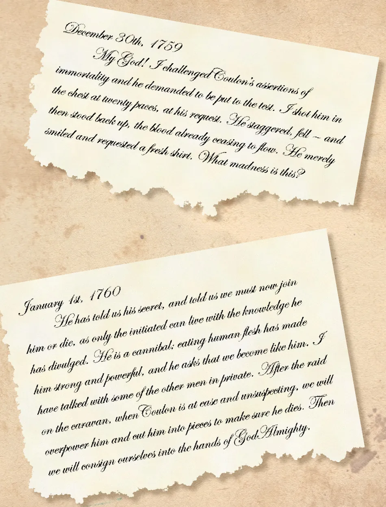

> **Раздатка «Дневник траппера» (лист 3)**
>
> *30 декабря 1759 года.*
>
> *Боже мой! Я оспорил заявления Кулона о бессмертии, и он потребовал, чтобы его испытали. По его же просьбе я выстрелил ему в грудь с двадцати шагов. Он пошатнулся, упал — и снова встал, а кровь уже перестала течь. Он лишь улыбнулся и попросил чистую рубашку. Что это за безумие?*

<!-- -->

> **Раздатка «Дневник траппера» (лист 3, второй обрывок)**
>
> *1 января 1760 года.*
>
> *Он открыл нам свою тайну и сказал, что теперь мы должны присоединиться к нему или умереть: только посвящённые могут жить с тем, что он нам поведал. Он людоед; человеческая плоть сделала его сильным и могучим, и он просит нас стать такими же, как он. Я тайком поговорил с некоторыми из людей. После набега на обоз, когда Кулон расслабится и ничего не будет подозревать, мы одолеем его и разрубим на куски, чтобы наверняка умер. А потом предадим себя в руки Господа Всемогущего.*
