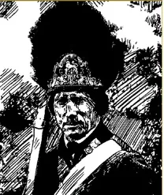

# Готовые сыщики

## Сержант Джон Эмброуз



**Сыщик эпохи 1760-х**

| Поле листа | |
|---|---|
| Имя | Сержант Джон Эмброуз (Sergeant John Ambrose) |
| Игрок | — |
| Профессия | британский гренадер (British Grenadier) |
| Возраст | 31 |
| Пол | муж. |
| Место жительства | форт Ниагара, колония Нью-Йорк |
| Место рождения | Брентвуд, Великобритания |

```stat
Характеристики
СИЛ 75 (37/15)    ЛВК 65 (32/13)    ИНТ 45 (22/9)
ВЫН 60 (30/12)    НАР 50 (25/10)    МОЩ 60 (30/12)
ТЕЛ 90 (45/18)    ОБР 40 (20/8)     Скорость 7

ПЗ 15    Рассудок 60    ПМ 12    Удача 50

Навыки
Ближний бой (драка)             36% (18/7)
Ближний бой (копьё)             50% (25/10)
Бухгалтерское дело              15% (7/3)
Верховая езда                   25% (12/5)
Внимание                        40% (20/8)
Запугивание                     45% (22/9)
Иностранный язык (французский)  50% (25/10)
Метание                         60% (30/12)
Ориентирование                  30% (15/6)
Психология                      30% (15/6)
Родной язык (английский)        40% (20/8)
Слух                            35% (17/7)
Средства                        20% (10/4)
Стрельба (винтовка/дробовик)    65% (32/13)
Уклонение                       42% (21/8)

Бой: бонус к урону +1d6, Комплекция 2, Уклонение 42% (21/8)
```

**Оружие**

| Оружие | Обычный | Трудный | Чрезвычайный | Урон | Дальность | Атак за раунд | Зарядов | Осечка |
|---|---|---|---|---|---|---|---|---|
| Без оружия | 36 | 18 | 7 | 1d3 + БкУ | — | 1 | — | — |
| Мушкет | 65 | 32 | 13 | 1d8 + 4 | 40 м | 1/4 | 1 | 97 |
| Штык | 50 | 25 | 10 | 1d6 + БкУ | — | 1 | — | — |

*Остальные поля листа — шкалы ПЗ, Рассудка, ПМ и Удачи (отмечены текущие значения), отметки «Серьёзная рана», «При смерти», «Без сознания», «Временное безумие», «Бессрочное безумие» и пустые строки навыков — стандартные, не заполнены.*
