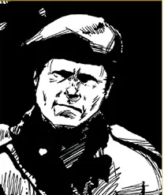

## Рядовой Джеймс Шаддок



**Сыщик эпохи 1760-х**

| Поле листа | |
|---|---|
| Имя | Рядовой Джеймс Шаддок (Private James Shaddock) |
| Игрок | — |
| Профессия | британский пехотинец регулярной армии (British Regular Infantryman) |
| Возраст | 28 |
| Пол | муж. |
| Место жительства | форт Ниагара, колония Нью-Йорк |
| Место рождения | Брентвуд, Великобритания |

```stat
Характеристики
СИЛ 50 (25/10)    ЛВК 70 (35/14)    ИНТ 50 (25/10)
ВЫН 90 (45/18)    НАР 50 (25/10)    МОЩ 50 (25/10)
ТЕЛ 60 (30/12)    ОБР 45 (22/9)     Скорость 8

ПЗ 15    Рассудок 50    ПМ 10    Удача 40

Навыки
Ближний бой (драка)             25% (12/5)
Ближний бой (топор)             55% (27/11)
Внимание                        50% (25/10)
Выживание (леса)                40% (20/8)
Иностранный язык (ирокезский)   36% (18/7)
Иностранный язык (французский)  40% (20/8)
Лазание                         40% (20/8)
Ориентирование                  35% (17/7)
Первая помощь                   40% (20/8)
Родной язык (английский)        45% (22/9)
Скрытность                      50% (25/10)
Слух                            45% (22/9)
Средства                        15% (7/3)
Стрельба (винтовка/дробовик)    55% (27/11)
Чтение следов                   35% (17/7)
Уклонение                       55% (27/11)

Бой: бонус к урону нет, Комплекция 0, Уклонение 55% (27/11)
```

**Оружие**

| Оружие | Обычный | Трудный | Чрезвычайный | Урон | Дальность | Атак за раунд | Зарядов | Осечка |
|---|---|---|---|---|---|---|---|---|
| Без оружия | 25 | 12 | 5 | 1d3 + БкУ | — | 1 | — | — |
| Мушкет | 55 | 27 | 11 | 1d8 + 4 | 40 м | 1/4 | 1 | 97 |
| Топорик | 55 | 27 | 11 | 1d6 + БкУ | — | 1 | — | — |

*Остальные поля листа — шкалы ПЗ, Рассудка, ПМ и Удачи (отмечены текущие значения), отметки «Серьёзная рана», «При смерти», «Без сознания», «Временное безумие», «Бессрочное безумие» и пустые строки навыков — стандартные, не заполнены.*
