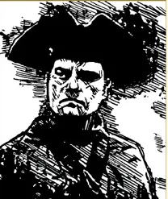

## Арнольд Говард



**Сыщик эпохи 1760-х**

| Поле листа | |
|---|---|
| Имя | Арнольд Говард (Arnold Howard) |
| Игрок | — |
| Профессия | фермер / колониальный ополченец (Farmer/Colonial Militiaman) |
| Возраст | 38 |
| Пол | муж. |
| Место жительства | форт Ниагара, колония Нью-Йорк |
| Место рождения | Скенектади, колония Нью-Йорк |

```stat
Характеристики
СИЛ 70 (35/14)    ЛВК 45 (22/9)     ИНТ 75 (37/15)
ВЫН 65 (32/13)    НАР 55 (27/11)    МОЩ 50 (25/10)
ТЕЛ 75 (37/15)    ОБР 55 (27/11)    Скорость 7

ПЗ 14    Рассудок 50    ПМ 10    Удача 50

Навыки
Ближний бой (драка)                  25% (12/5)
Ближний бой (топор)                  45% (22/9)
Внимание                             50% (25/10)
Естествознание                       55% (27/11)
Искусство/ремесло (земледелие)       65% (32/13)
Искусство/ремесло (плотницкое дело)  45% (22/9)
Обращение с животными                45% (22/9)
Родной язык (английский)             55% (27/11)
Слух                                 45% (22/9)
Средства                             30% (15/6)
Стрельба (винтовка/дробовик)         45% (22/9)
Убеждение                            55% (27/11)
Управление повозкой                  40% (20/8)
Чтение следов                        20% (10/4)
Уклонение                            22% (11/4)

Бой: бонус к урону +1d4, Комплекция 1, Уклонение 22% (11/4)
```

**Оружие**

| Оружие | Обычный | Трудный | Чрезвычайный | Урон | Дальность | Атак за раунд | Зарядов | Осечка |
|---|---|---|---|---|---|---|---|---|
| Без оружия | 25 | 12 | 5 | 1d3 + БкУ | — | 1 | — | — |
| Мушкет | 45 | 22 | 9 | 1d8 + 4 | 40 м | 1/4 | 1 | 97 |
| Топорик | 45 | 22 | 9 | 1d6 + БкУ | — | 1 | — | — |

*Остальные поля листа — шкалы ПЗ, Рассудка, ПМ и Удачи (отмечены текущие значения), отметки «Серьёзная рана», «При смерти», «Без сознания», «Временное безумие», «Бессрочное безумие» и пустые строки навыков — стандартные, не заполнены.*
