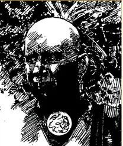

## Бегущий Лис



**Сыщик эпохи 1760-х**

| Поле листа | |
|---|---|
| Имя | Бегущий Лис (Running Fox) |
| Игрок | — |
| Профессия | воин-сенека (Seneca Warrior) |
| Возраст | 26 |
| Пол | муж. |
| Место жительства | форт Ниагара, колония Нью-Йорк |
| Место рождения | клан Черепахи, народ сенека |

```stat
Характеристики
СИЛ 60 (30/12)    ЛВК 55 (27/11)    ИНТ 60 (30/12)
ВЫН 55 (27/11)    НАР 35 (17/7)     МОЩ 60 (30/12)
ТЕЛ 65 (32/13)    ОБР 80 (40/16)    Скорость 7

ПЗ 12    Рассудок 60    ПМ 12    Удача 35

Навыки
Ближний бой (драка)             70% (35/14)
Внимание                        55% (27/11)
Выживание (леса)                60% (30/12)
Естествознание                  65% (32/13)
Иностранный язык (английский)   31% (15/6)
Иностранный язык (французский)  21% (10/4)
Лазание                         55% (27/11)
Метание                         40% (20/8)
Оккультизм                      20% (10/4)
Плавание                        35% (17/7)
Родной язык (сенека)            80% (40/16)
Слух                            50% (25/10)
Средства                        15% (7/3)
Стрельба (винтовка/дробовик)    40% (20/8)
Чтение следов                   35% (17/7)
Уклонение                       27% (13/5)

Бой: бонус к урону +1d4, Комплекция 1, Уклонение 27% (13/5)
```

**Оружие**

| Оружие | Обычный | Трудный | Чрезвычайный | Урон | Дальность | Атак за раунд | Зарядов | Осечка |
|---|---|---|---|---|---|---|---|---|
| Без оружия | 70 | 35 | 14 | 1d3 + БкУ | — | 1 | — | — |
| Мушкет | 40 | 20 | 8 | 1d8 + 4 | 40 м | 1/4 | 1 | 97 |
| Боевая палица | 70 | 35 | 14 | 1d6 + БкУ | — | 1 | — | — |

*Остальные поля листа — шкалы ПЗ, Рассудка, ПМ и Удачи (отмечены текущие значения), отметки «Серьёзная рана», «При смерти», «Без сознания», «Временное безумие», «Бессрочное безумие» и пустые строки навыков — стандартные, не заполнены.*
