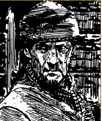

## Джеймс Бэр / Бродячий Медведь



**Сыщик эпохи 1760-х**

| Поле листа | |
|---|---|
| Имя | Джеймс Бэр / Бродячий Медведь (James Bear/Wandering Bear) |
| Игрок | — |
| Профессия | воин-сенека (Seneca Warrior) |
| Возраст | 24 |
| Пол | муж. |
| Место жительства | форт Ниагара, колония Нью-Йорк |
| Место рождения | клан Черепахи, народ сенека |

```stat
Характеристики
СИЛ 55 (27/11)    ЛВК 60 (30/12)    ИНТ 60 (30/12)
ВЫН 85 (42/17)    НАР 60 (30/12)    МОЩ 55 (27/11)
ТЕЛ 50 (25/10)    ОБР 50 (25/10)    Скорость 9

ПЗ 13    Рассудок 55    ПМ 11    Удача 60

Навыки
Ближний бой (драка)             45% (22/9)
Внимание                        45% (22/9)
Выживание (леса)                50% (25/10)
Естествознание                  70% (35/14)
Иностранный язык (английский)   31% (15/6)
Иностранный язык (французский)  36% (18/7)
Лазание                         40% (20/8)
Оккультизм                      10% (5/2)
Первая помощь                   50% (25/10)
Плавание                        30% (15/6)
Родной язык (сенека)            50% (25/10)
Слух                            40% (20/8)
Средства                        15% (7/3)
Стрельба (винтовка/дробовик)    35% (17/7)
Чтение следов                   70% (35/14)
Уклонение                       30% (15/6)

Бой: бонус к урону нет, Комплекция 0, Уклонение 30% (15/6)
```

**Оружие**

| Оружие | Обычный | Трудный | Чрезвычайный | Урон | Дальность | Атак за раунд | Зарядов | Осечка |
|---|---|---|---|---|---|---|---|---|
| Без оружия | 45 | 22 | 9 | 1d3 + БкУ | — | 1 | — | — |
| Мушкет | 35 | 17 | 7 | 1d8 + 4 | 40 м | 1/4 | 1 | 97 |
| Боевая палица | 45 | 22 | 9 | 1d6 + БкУ | — | 1 | — | — |

*Остальные поля листа — шкалы ПЗ, Рассудка, ПМ и Удачи (отмечены текущие значения), отметки «Серьёзная рана», «При смерти», «Без сознания», «Временное безумие», «Бессрочное безумие» и пустые строки навыков — стандартные, не заполнены.*
