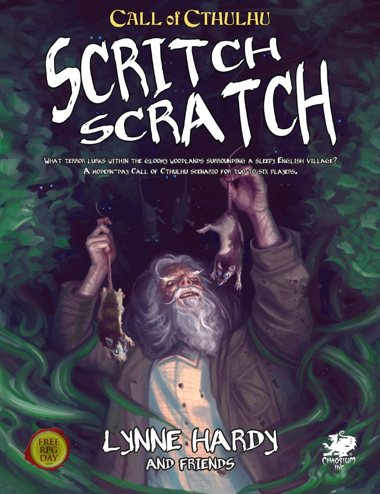

ЦАП-ЦАРАП

Линн Харди и друзья

*На обложке — надпись «Call of Cthulhu» («Зов Ктулху»), название «Scritch Scratch» («Цап-царап») и подзаголовок: «Какой ужас таится в мрачных лесах, окружающих сонную английскую деревушку? Сценарий для „Зова Ктулху“ в наши дни, для двух–шести игроков». Ниже — седобородый старик в лесу, среди зелёных побегов, держит за хвосты дохлых крыс; внизу — «Lynne Hardy and Friends» («Линн Харди и друзья»), значок «Free RPG Day 2018» и логотип Chaosium Inc.*
