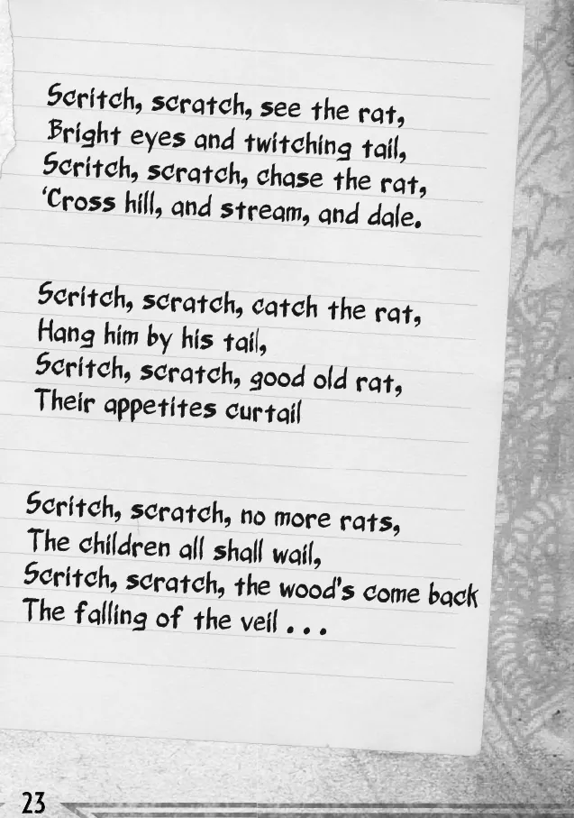

Готовые сыщики — работники уборочной фирмы, которую Совет нанял вывезти обычный мусор из коттеджа старого Гуртина, его хозяйственных построек и прилегающего к участку леса. Когда уборщики расчистят жилище, придут рабочие Совета и сделают в доме необходимый ремонт. Однако Совет был не вполне честен с бригадой Пола Мартина, и ни уборщики, ни сопровождающая их съёмочная группа понятия не имеют, какое кладбище падали их ждёт. Насколько известно Мартину, Совет так щедро заплатил лишь потому, что хочет поскорее закончить работу, а вовсе не потому, что дело нечисто.

> **Раздатка 1: «Цап-царап»**
>
> Цап-царап, вот крыса,  
> Глазки блестят, хвостик дрожит,  
> Цап-царап, гони крысу  
> Через холм, ручей и дол.
>
> Цап-царап, лови крысу,  
> Вешай за хвост,  
> Цап-царап, добрая крыса,  
> Их голод уйми.
>
> Цап-царап, нет больше крыс,  
> Дети все заплачут,  
> Цап-царап, лес вернулся —  
> Падает завеса…

<!-- -->

> ### Колёса в колёсах
>
> В одной из тестовых игр сыщики уверились, что Совет нарочно подставил их в жертву, чтобы умилостивить Зелёного человека! Подозрение возникло потому, что Мартинам почти ничего не сообщили о работе. Но всё не так зловеще: Совет просто пытается сделать дело как можно дешевле. Если бы он заранее признался уборщикам, что их ждёт, это обошлось бы ему куда дороже, чем он сейчас платит Полу Мартину, — впрочем, тот вполне может захотеть пересмотреть условия договора, когда узнает причину видимой «щедрости» Совета.

## Альтернативные завязки

Если вы не используете готовых сыщиков, игроки могут взять на себя роль оценочной группы Совета, присланной оценить, какие работы нужно провести в коттедже, прежде чем Гуртина выпишут из больницы. В этом случае кое-кто в группе знает о жутких «украшениях», ждущих их за коттеджем, но вовсе не обязательно все. Просветят ли они коллег до приезда — решать только им. У группы есть ключи Гуртина: после несчастного случая их достали из-под цветочного горшка у входной двери. (Гуртин всегда запирал только заднюю дверь — ту, что выходит в лес, — но Совет на всякий случай взял за правило запирать всё.)

Если игроки — члены исторического общества или учёные-исследователи, они могли наткнуться на крыс и коттедж Гуртина, посещая соседнюю церковь, или приехать в поисках легендарного крысолова Маскоби и его жуткого кладбища падали: с долиной связан печально известный в округе детский стишок, который вполне мог разжечь их интерес (см. **раздатку 1: «Цап-царап»**). Возможно даже, что слухи о висящих грызунах разошлись в оккультном подполье и привлекли исследователей совсем иного сорта. В таких обстоятельствах в коттедж Гуртина можно попасть через загадочным образом распахнутую настежь заднюю дверь. (Которая, конечно же, должна быть заперта…)

Если игроки — следственная группа, их вызвали в Маскоби либо потому, что во время прогулки по лесу пропал турист, либо потому, что исчез один или несколько членов оценочной группы Совета или бригады уборщиков и съёмочной группы. Позже по ходу сценария Хранителю стоит позаботиться, чтобы сыщики наткнулись на иссохшие тела пропавших. Как и у группы Совета, в коттедж можно попасть с ключами Гуртина — если, конечно, пропавший не унёс их с собой.
