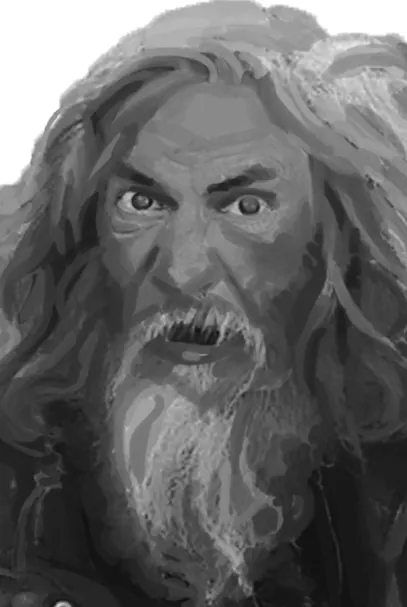
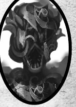

## Действующие лица

Есть несколько персонажей Хранителя, к которым сыщики могут обратиться в поисках улик. Их характеристики при необходимости смотрите в **приложении A: «Персонажи и чудовища»**, с. 21.

### Миссис Люси Олбрайт

- Хозяйка едва сводящей концы с концами чайной в Маскоби.

Миссис Олбрайт решила начать жизнь заново семь месяцев назад, после тяжёлого расставания с мужем, с которым прожила больше 25 лет. Она позволила ему выкупить её долю в их общем ресторанном деле в городе и открыла собственное маленькое кафе в деревне, которая казалась ей картинкой с открытки. Она всегда любила местную историю и твёрдо решила завести новых друзей, поэтому вступила в Эпплфордское историческое общество — и лишь тогда узнала о довольно скверной репутации Маскоби; об этом агент по недвижимости усердно помалкивал, пока она не подписала бумаги о покупке старой почты. Что ж, раз уж она здесь, можно извлечь из этого всё возможное.

### Миссис Джойс Дикинс

- Заведующая библиотекой, хранитель пыльного музея Эпплфорда и секретарь городского Исторического общества.

Миссис Дикинс и её тихий, как мышка, муж Артур вместе руководят Эпплфордским историческим обществом уже лет сорок, плюс-минус. Гордая жительница древнего торгового городка, миссис Дикинс почти не выезжала за пределы графства, которое считает лучшим на свете. Ну, по крайней мере, оно было бы лучшим, если бы не крысолов из Маскоби и его ужасный детский стишок. Несмотря на обычно здравый склад ума, что-то в стишке «Цап-царап» и в дохлых крысах, висящих на деревьях Маскоби, пробуждает в ней первобытный страх, и если она слишком долго об этом думает, у неё может случиться приступ стенокардии.

### Старый Джордж

- Бывший житель Маскоби; теперь его можно найти у стойки «Золотого барана» в Эпплфорде, где он травит байки всякому, кто готов слушать. За пинту, разумеется.

Мистер Джордж Флетчер-старший, как и многие его ровесники, в юности почти не выбирался из Маскоби — так было не принято. Но теперь, став Старым Джорджем, он рад, что уехал оттуда, от этого места и его проклятого леса, и рад, что его внуки могут расти, не оглядываясь в страхе через плечо, не идут ли за ними деревья. И всё же какая-то часть его скучает по Маскоби, но возвращаться туда даже ненадолго у него нет ни малейшего желания.

### Молодой Джордж

- Сын Старого Джорджа и многотерпеливый хозяин «Золотого барана» в Эпплфорде.

Хотя в церкви Маскоби его крестили как Джорджа Флетчера-младшего, этого в основном добродушного хозяина паба все знают как Молодого Джорджа. Пухлый, краснолицый, с вечной щетиной к вечеру, Молодой Джордж принял «Герб крысолова» от отца жены, когда тот ушёл на покой. Либо так, либо уезжать из деревни. Он бы не очень возражал, но его овдовевший отец хотел остаться. По крайней мере, до этого лета, когда и жена, и отец объявили, что пора обзавестись домом в другой долине. По Маскоби и его странному лесу он совсем не скучает.

### Старый Гуртин

- Бывший крысолов Маскоби, теперь лежит в больнице в Эпплфорде.

Когда-то крупный, крепкий человек тихого нрава и непоколебимой решимости, Гилберт Освин Гуртин теперь лишь тень себя прежнего. Обезумев от знания о том, что случится с Маскоби, если он не будет приносить Зелёному человеку ежедневную дань, он строит планы побега из больницы, отчаянно надеясь, что ещё не поздно помешать деревьям проснуться и забрать жизни невинных.

### Зелёный человек

- Проявление Внешнего бога Ньярлатхотепа, обитающее в Маскоби.

Некогда широко почитаемое воплощение Ползучего Хаоса, в полном своём облике Зелёный человек предстаёт человекоподобной фигурой, целиком сложенной из извивающейся, корчащейся листвы. В Маскоби он предпочитает не являться во всей полноте, а нападать из своих изображений — будь то печатные, деревянные или каменные. Однако если он заподозрит, что добыча ускользает, то пойдёт на всё, чтобы её остановить, вплоть до того, чтобы принять свой полный растительный облик.

*Прим. перев.: в оригинале название стишка в описании миссис Дикинс напечатано с опечаткой — «Scrtich Scratch».*
