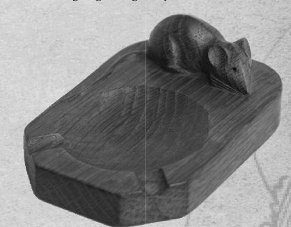

Жители Маскоби больше не поклоняются ему напрямую, но народная память о чём-то опасном в лесу не давала прекратиться жертвоприношениям грызунов и с незапамятных времён удерживала его на расстоянии. Более того, лес за коттеджем старого Гуртина — это привязь Зелёного человека, и если лес сгорит, привязь может порваться и навсегда избавить округу от его присутствия.

> ### «Мышиный человек»
>
> Роберт Томпсон, родившийся в конце XIX века, жил и работал в деревне Килберн в Северном Йоркшире. Сын деревенского плотника и столяра, он недолго учился на механика, а потом перенял отцовское ремесло — стал умелым плотником и каменщиком и к концу 1920-х годов продавал свою дубовую мебель ручной работы по всему миру. Хотя мышь есть не на каждом изделии Томпсона или его мастерской, она стала символом фирмы — впервые она появилась в 1920 году. Благодаря этой мышиной метке Томпсона и прозвали «Мышиным человеком». Обычай живёт и сейчас: фирма Robert Thompson’s Craftsmen по-прежнему процветает.
>
> 

## Маскоби

Дорога в Маскоби довольно новая, но путь через крутые холмы, которым она петляет к деревне, — древний. Миновав перевал и гребень холма, можно увидеть деревню, раскинувшуюся в долине внизу, хотя сквозь непрерывно моросящий дождь трудно разглядеть подробности. Въезд в Маскоби отмечает непомерно большая стоянка (тоже новая). Единственная главная дорога змеится вверх через кучку домов, из которых и состоит деревня, а у леса на дальнем склоне долины сходит на нет, превращаясь едва ли не в проулок. Маленькая церковь приземисто сидит посреди чего-то вроде поля примерно в 800 метрах от деревни (см. **раздатку 2: «Маскоби»**).

Когда сыщики приезжают, стоит конец лета, сезон отпусков почти закончился, и, когда они проезжают мимо стоянки, на ней тихо стоят лишь несколько машин. Если сыщикам захочется остановиться и осмотреть стоянку, большой яркий информационный щит сообщит, что Маскоби находится в местности выдающейся природной красоты, — в это, пожалуй, трудно поверить в такой сырой серый день. Там же кратко упомянуты историческая англосаксонская церковь деревни и её многочисленные каменные мыши, которые, как считается, вдохновили Роберта Томпсона, так называемого «Мышиного человека», избрать свою фирменную резную метку.

Если сыщики — группа, присланная сюда местным советом, у них есть указания, как добраться до коттеджа старого Гуртина. Если же они не знают, где коттедж старого Гуртина, им, возможно, придётся спросить дорогу. Самое очевидное место для этого — «Чайная Люси», на месте бывшей деревенской почты.

## Чайная Люси

Перед чайной, на мощённом камнем пятачке, стоит деревянный стол для пикника, накрытый красно-белой клетчатой скатертью, придавленной расписными камешками. На стене над сохранившимся красным почтовым ящиком хорошо видна старая вывеска почты. Учитывая не по сезону холодную и сырую погоду, неудивительно, что за столом никого нет.

Когда входишь в чайную, звякает медный колокольчик над дверью. Внутри кафе несколько столиков, все накрыты той же весёлой клетчатой тканью, что и стол снаружи, и на каждом — банка из-под варенья со свежими цветами. Стены увешаны акварелями местных художников и фарфоровыми тарелками из добрых дюжины разных сервизов. Всё это очень похоже на образцовое представление о милой британской чайной — вплоть до рядов больших коричневых чайников на буфете за стойкой. В воздухе пахнет свежей выпечкой.

На звон колокольчика из помещения, которое, по-видимому, служит кухней, выходит женщина средних лет с пепельно-светлыми волосами. В зависимости от времени дня за одним-двумя столиками могут сидеть запоздалые туристы, уплетающие сэндвичи с беконом, чай с пирогом или сытный «обед пахаря», и все рады укрыться от дождя. Поскольку они британцы, они упорно не замечают новоприбывших.
