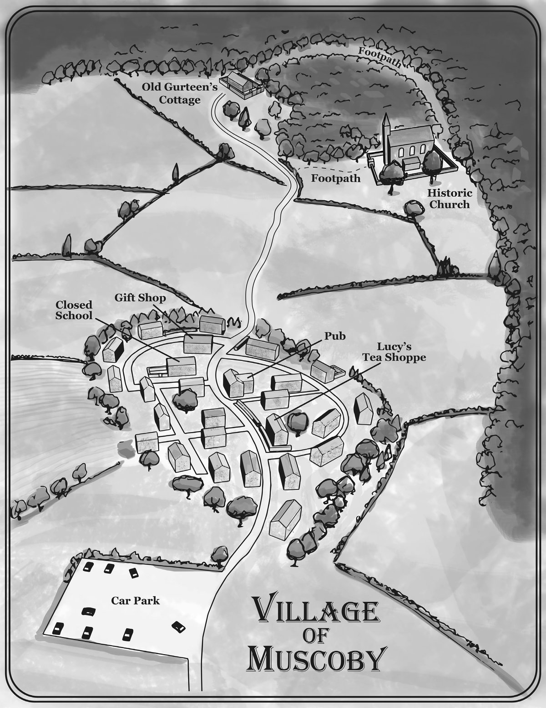

## Раздатка 2: «Маскоби»

> **Раздатка 2: «Маскоби»** — карта деревни Маскоби
>
> | Подпись на карте | Перевод |
> |---|---|
> | Village of Muscoby | Деревня Маскоби |
> | Old Gurteen’s Cottage | Коттедж старого Гуртина |
> | Footpath (у леса) | Тропа (через лес от коттеджа к церкви) |
> | Footpath (у церкви) | Тропа (к церкви) |
> | Historic Church | Историческая церковь (церковь Святой Гертруды) |
> | Closed School | Закрытая школа |
> | Gift Shop | Сувенирная лавка |
> | Pub | Паб («Герб крысолова») |
> | Lucy’s Tea Shoppe | Чайная Люси |
> | Car Park | Стоянка |
>
> Лес на карте не подписан: он тянется по краю долины от коттеджа старого Гуртина к церкви.
