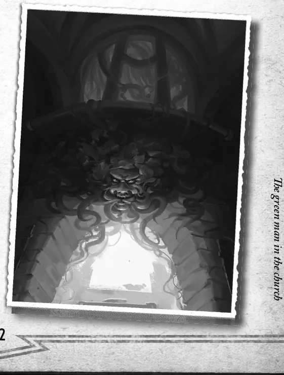

(это подтверждает взгляд сквозь тёмно-зелёный витраж в восточной стене).

Если присмотреться к наружным стенам внимательнее, те, кто разбирается в истории или архитектуре, уверены, что большая часть камня, из которого сложена церковь, куда старше самого здания. Кроме того, на многих камнях есть отметины или вырезаны необычные символы. Навык **Иностранный язык (латынь)** или **История** на 10% и выше (без проверки) позволяет опознать некоторые из этих странных надписей как римские, хотя толком перевести их невозможно — так сильно камень выветрился за прошедшие века. Как ни странно, местами в каменной кладке вырезаны ещё и лиры и примитивные луки; успешная проверка **Истории** показывает, что это символы греко-римского бога Аполлона. Трудный успех напоминает, что одно из многих воплощений Аполлона звалось «Аполлон Сминфей», Владыка мышей, — он был то ли насылателем чумы, то ли древним земледельческим богом, хранившим посевы от нашествий крыс.

### Церковь внутри

На крыльце церкви, на трухлявой доске объявлений, висят несколько выцветших рукописных объявлений. Одно — о прошлогоднем деревенском празднике, другое — расписание служб на текущий год. Как во многих уединённых деревенских церквях, еженедельной службы здесь больше нет: викарий всей округи по очереди объезжает приходы и их церкви. В Маскоби теперь, похоже, лишь одна утренняя служба в месяц, хотя, судя по размеру здания, большой паствы у церкви не бывало и в лучшие времена. Тяжёлая дубовая дверь, обитая гвоздями, не заперта.

Внутри — простой неф. Складные деревянные стулья составлены у стен, почти голых, если не считать резного фриза с резвящимися грызунами, который тянется по глухой северной стене чуть выше человеческого роста. Обрамления окон и двери тоже покрыты резными мышами и крысами разной величины; их глазки-бусинки наблюдают за сыщиками в буквальном смысле в каменном молчании. На маленькой книжной полке у двери — дюжина сборников гимнов и порядков богослужения. Они пахнут сыростью, и их явно кто-то грыз.

Пока сыщики в церкви, успешная проверка **Слуха** различает безошибочный звук: что-то маленькое шмыгает туда-сюда, — хотя поиски виновника не находят ничего, кроме мышиного помёта и множества паутины.

#### Мышиная связь

Видя такое множество мышиных стражей, разрешите всем, у кого **Иностранный язык (латынь)**, **История** или **Наука (биология или зоология)** на 10% и выше, пройти проверку навыка. Успех позволяет вспомнить, что «мышь» по-латыни — «mus»; видимо, отсюда и происходит название Маскоби. По какой-то причине эта долина, похоже, более чем немного одержима грызунами. Если ни у кого нет нужных навыков, позже сыщиков может просветить миссис Дикинс в Эпплфордской библиотеке и музее (с. 18).

#### Каменные стражи

Ближе к середине западной стены стоит купель, густо покрытая резьбой. На ней изображены не представители семейства мышиных (грызуны), а буйно разросшиеся лозы, которые ползут по её поверхности и забираются глубоко в чашу. Между листьями выглядывают странные лица, напоминающие зелёного человека. Резьба на купели сильно стёрта, а стиль довольно наивен — это наводит на мысль, что купель, как и многие камни в стене, намного старше церкви. Крышки у купели нет.

Другое, куда большее лицо зелёного человека хмуро смотрит со стены над аркой, ведущей к главному алтарю в восточном конце церкви. Искусно сложенное из одних резных листьев, это лицо, кажется, смотрит прямо сквозь всякого, кто на него взглянет. Губы изогнуты в насмешливой улыбке. Успешная проверка **Науки (биология или ботаника)** определяет, что искусно вырезанная зелень изображает дубовые листья. Те, кто разбирается в истории, оккультизме или архитектуре, знают, что зелёных людей часто можно встретить в средневековых церквях, но такой огромный образец — большая редкость. Витраж над главным алтарём —

