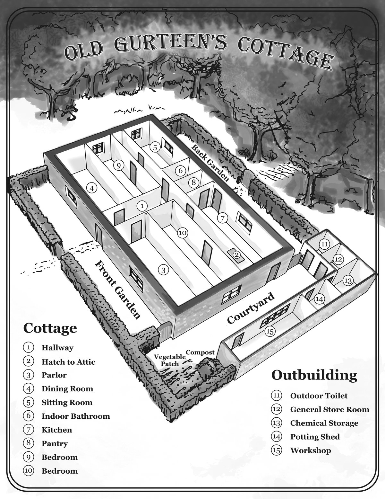

## Раздатка 3: «Коттедж»

> **Раздатка 3: «Коттедж»** — план коттеджа старого Гуртина (Old Gurteen’s Cottage)
>
> **Коттедж (Cottage)**
>
> | № | На плане | Перевод |
> |---|---|---|
> | 1 | Hallway | Прихожая |
> | 2 | Hatch to Attic | Люк на чердак |
> | 3 | Parlor | Гостиная |
> | 4 | Dining Room | Столовая |
> | 5 | Sitting Room | Общая комната |
> | 6 | Indoor Bathroom | Ванная |
> | 7 | Kitchen | Кухня |
> | 8 | Pantry | Кладовая |
> | 9 | Bedroom | Спальня |
> | 10 | Bedroom | Спальня |
>
> **Хозяйственная постройка (Outbuilding)**
>
> | № | На плане | Перевод |
> |---|---|---|
> | 11 | Outdoor Toilet | Уличная уборная |
> | 12 | General Store Room | Кладовая |
> | 13 | Chemical Storage | Химический склад |
> | 14 | Potting Shed | Сарай для рассады |
> | 15 | Workshop | Мастерская |
>
> Прочие подписи: Front Garden — палисадник; Back Garden — сад за домом; Courtyard — двор; Vegetable Patch — огород; Compost — компостная куча.

*Прим. перев.: обе спальни на плане подписаны одинаково («Bedroom»). По тексту (с. 14) спальня за столовой — старого Гуртина (№ 9), спальня за гостиной — его родителей (№ 10).*
