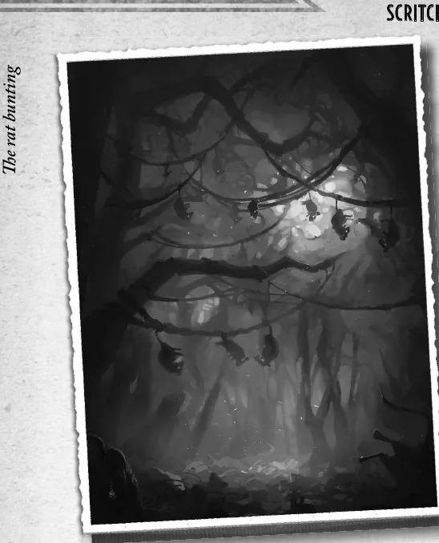

#### Ползучий ужас

Всякий раз, когда сыщики возвращаются в коттедж после первого посещения, лес подбирается немного ближе к задней живой изгороди. Сдвиг так велик, что проверка, чтобы его заметить, не нужна, и его легко измерить: между их приходами лес продвигается примерно на 0,3 метра.

#### Как войти в лес

Через лес можно пройти от коттеджа старого Гуртина до деревенской церкви. Если сыщики решают так и сделать, потребуйте проверку двух навыков — **Внимания** и **Слуха**. При успехе возникает отчётливое ощущение, что за ними следят, и эти сыщики слышат (и видят), как шевелятся ветви деревьев, хотя ветра нет. Ощущение тревожное; при желании Хранитель может потребовать проверку Рассудка (потеря 0/1).

*Примечание для Хранителя*: постарайтесь, чтобы сыщики попали в лес при первом же посещении коттеджа и как можно скорее нашли жуткие следы занятий старого Гуртина. Если они приезжают к дому поздно, сначала побывав в других местах, пусть их привлечёт запах гниющего мяса, едва они выйдут из машин. Если ещё не стемнело, их внимание может привлечь и странное движение деревьев, а также шорох и мелькание маленьких пушистых созданий, убегающих в лес.

## Эпплфорд

Торговый городок Эпплфорд лежит через несколько долин от Маскоби, примерно в 32 километрах, и теперь, когда универсальный магазин в бывшей деревенской почте закрылся, это ближайший крупный торговый центр. Город старый и скорее практичный, чем красивый; Совет и здесь пытается привлечь побольше приезжих, и местные библиотека и музей всей душой это поддерживают.

В Эпплфорде три места, которые могут заинтересовать сыщиков: «Золотой баран», библиотека и музей и районная больница.

## «Золотой баран»

На одной стороне главной рыночной площади Эпплфорда, почти напротив библиотеки и музея, стоит паб «Золотой баран». Над дверью висит большая деревянная вывеска с изображением довольно недовольного на вид желтоватого барана. На табличке с лицензией — то же имя, что и над «Гербом крысолова» в Маскоби: «мистер Джордж Флетчер, эсквайр».

Если сыщики приходят раньше 10:00, свежевыкрашенные чёрные двери заперты. На табличке в окне рядом с дверью указаны часы работы: «С 10 утра и допоздна» — восхитительно расплывчато по любым меркам. Если они приходят после открытия, то, смотря по времени, застают Молодого Джорджа за уборкой грязных стаканов со вчерашнего вечера или за тем, что он придумывает себе занятие за стойкой.

Обстановка паба незамысловатая. Похоже, недавно кто-то — вероятно, пивоварня — оформил его «под старину», но потом кто-то другой планомерно убрал самые худшие современные подделки и заменил их настоящими вещами. На одной стене висит мишень для дартса, а поперёк ковра наклеены полоски скотча, отмечающие «оки» (линию броска — где стоит игрок, бросая дротики).

Если время позднее, посетителей, вероятно, больше, но у стойки всегда сидит одна и та же душа — Старый Джордж, отец Молодого Джорджа. Одетый в поношенный твидовый пиджак, протёртые вельветовые брюки, клетчатую рубашку и плоскую кепку, он упорно курит трубку, вопиюще пренебрегая запретом на курение.

Вопрос бармену о Маскоби вызывает тяжёлый вздох и закатывание глаз. Старый Джордж, напротив, тут же оживляется. *«Я вам всё про Маскоби расскажу, коли угостите пинтой»*, — заявляет он и подмигивает. Молодой Джордж, который явно слышал эту историю гораздо чаще, чем готов признать, наливает отцу пинту и отходит в другой конец стойки или отправляется старательно смахивать пыль с оленьей головы над камином в зале.
