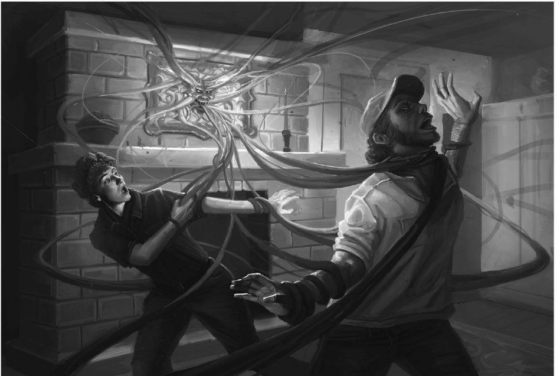

Если сценарий близится к концу, а сыщики избегают возвращаться в церковь, коттедж или лес, Зелёный человек пользуется любой возможностью, какая ему подвернётся. На домах в деревне много терракотовых плиток с ликом зелёного человека, через которые он может явиться, и хотя садовые деревья и кусты — некоторое понижение по сравнению с его собственным лесом, для его присутствия они тоже вполне годятся.

Прямо перед нападением разрешите сыщикам проверку двух навыков — **Внимания** и **Слуха**. При успехе они слышат вокруг себя шорох и топоток и краем глаза замечают маленькие гладкие тельца, перебегающие от укрытия к укрытию, — даже если сыщики внутри коттеджа. Даже если сыщики ничего такого не заметили, когда Зелёный человек заявляет о себе, шум становится безошибочным.

Если сыщики пытаются бежать от Зелёного человека, их уже поджидает армия крыс со зловеще горящими глазами. Крысы делают всё возможное, чтобы не дать сыщикам уйти, — в конце концов, им куда больше нравится, когда их место занимают люди. Каждая смерть помогает насытить Зелёного человека, но если в Маскоби не вернётся крысолов, круг будет повторяться всякий раз, как деревья снова проголодаются.

Характеристики Зелёного человека и крысиных стай см. в **приложении A: «Персонажи и чудовища»**.

## Заключение

Спастись от Зелёного человека, крыс и Маскоби можно. Например, взорвать коттедж с помощью газовой плиты или поджечь Зелёного человека химикатами из кладовой и прогнать его. Поджечь лес — вернейший способ покончить с «проклятием», хотя можно и просто прыгнуть в машину и как можно быстрее умчаться из деревни (возможно, понадобится успешная проверка **Вождения автомобиля**, чтобы не разбиться в страхе и спешке).

Хранитель может захотеть, чтобы сыщики столкнулись с ордой крыс, даже если им удалось прогнать Зелёного человека. В конце концов, крысы прекрасно знают, что любая передышка лишь временна: такую древнюю и могучую силу не уничтожить окончательно так легко. Такое нападение может случиться в любой момент, пока сыщики в Маскоби, даже когда они уезжают, спасаясь из деревни: крысы и мыши облепляют машину, забивают двигатель и разбивают лобовое стекло, буквально бросаясь на сыщиков!

*Прим. перев.: в оригинале опечатка «literary throw themselves» вместо «literally» («буквально»).*

Если сыщики всё же выбираются из Маскоби и им хватает ума не возвращаться (и объяснить почему так, чтобы их не упекли в лечебницу, если работа ещё не закончена), через несколько месяцев объявляют о планах превратить долину в водохранилище. Совет наконец решил сократить убытки

