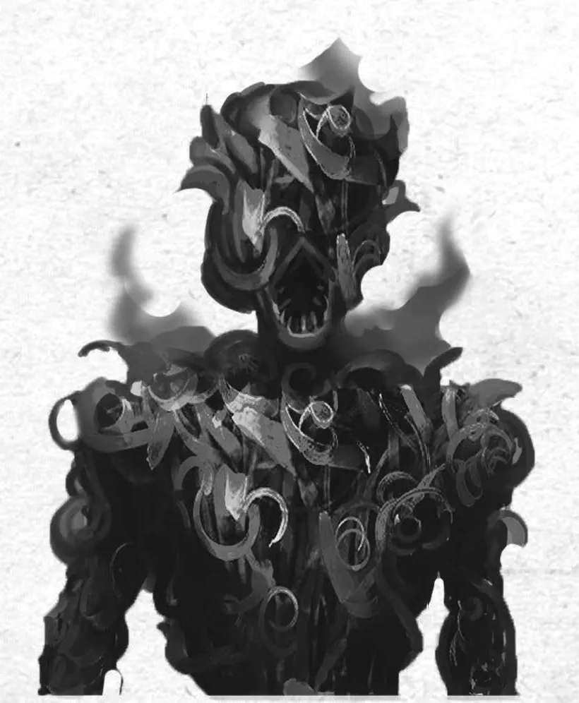

### Старый Гуртин, 71 год, крысолов

```stat
СИЛ 45   ВЫН 25   ТЕЛ 70   ЛВК 65   ИНТ 60
НАР 45   МОЩ 80   ОБР 50   Рассудок 0   ПЗ 9
БкУ: 0   Комплекция: 0   Скорость: 3   ПМ: 16

Бой
Драка        35% (17/7), урон 1d3
Уклонение    35% (17/7)

Навыки
Искусство/ремесло (кузнечное дело) 55%, Искусство/ремесло (крысолов) 95%, Электрика 60%, Первая помощь 40%, Родной язык (английский) 50%, Тайные знания (местный фольклор) 40%, Механика 60%, Естествознание 60%, Оккультизм 25%, Наука (химия) 40%, Метание 40%.
```

### Зелёный человек, воплощение Ньярлатхотепа

```stat
СИЛ 125*   ВЫН 345*   ТЕЛ 105*   ЛВК 100   ИНТ 130
НАР —      МОЩ 375    ОБР —      Рассудок —   ПЗ 45*
БкУ: +2d6   Комплекция: 3   Скорость: 8   ПМ: 75

* Базовое значение растёт, когда он кормится; у отдельной лозы СИЛ 70.

Бой
Атак за раунд: 2 (удары лозой, власть над растениями).

Атаки в ближнем бою: может лозами, из которых он состоит, хватать или пронзать жертв, высасывая их жизненную силу — 1d10 урона за раунд, пока не останется лишь сухая мёртвая оболочка. Высосанные из жертвы пункты здоровья поровну (с округлением вниз) делятся между СИЛ, ВЫН и ТЕЛ Зелёного человека. Например, жертва, потерявшая 8 ПЗ, добавляет по 2 к СИЛ, ВЫН и ТЕЛ Зелёного человека, а оставшиеся 2 пункта пропадают. Каждое кормление делает Зелёного человека сильнее, что проявляется в распускающихся цветах и зреющих плодах на его теле, а также в росте всей лиственной массы. Жертва может попытаться вырваться из хватки Зелёного человека встречной проверкой ЛВК, чтобы выскользнуть, или проверкой СИЛ против СИЛ одной лозы (70).

Власть над растениями (манёвр): по своей природе Зелёный человек может повелевать всеми растениями в радиусе 90 метров вокруг себя и управлять ими. Подвластные растения могут опутывать и удерживать жертв (чтобы вырваться, нужна успешная проверка СИЛ или ЛВК, иначе жертва удержана и все её действия идут со штрафной костью) или бросать плоды и семенные коробочки (жёлуди и т. п.) как метательные снаряды (цели могут уклониться от таких лиственных атак). В какой-то мере власть над растениями распространяется и на деревья леса: они могут медленно выкорчёвываться из земли, чтобы подобраться ближе к деревне в поисках кровавой дани. Однако двигаются они недостаточно быстро, чтобы дерево могло действительно гнаться за жертвой.

Удар лозой                     70% (35/14), урон 1d10 за раунд, может пронзить
Власть над растениями (манёвр) 70% (35/14), ближние растения нападают на
                               жертв как уместно, урон 1d3 или жертва удержана
Уклонение                      50% (25/10)

Броня: настоящей брони у Зелёного человека нет, но физическое оружие наносит ему лишь минимальный урон, и по своему желанию он может восстанавливать 2d6 ПЗ каждый раунд. Зелёный человек невосприимчив к большинству стихий, кроме огня (1d6–1d10 урона за раунд в зависимости от размера источника). Он полностью уязвим к химикатам, особенно к дефолиантам и гербицидам (которыми как раз забиты постройки старого Гуртина). Такие химикаты наносят ему 1d6 урона за каждое применение.
Заклинания: нет.
Потеря Рассудка: 1/1d6 Рассудка за то, чтобы увидеть Зелёного человека в полном воплощении. Видеть, как он высасывает жизнь из жертвы, стоит дополнительно 0/1d3 Рассудка.
```

*Прим. перев.: в оригинале ПЗ напечатаны «44\*»; по ВЫН 345 и ТЕЛ 105 выходит (345 + 105) / 10 = 45 — исправлено, как в базе.*



### Крысы

Отдельные крысы — противники недостойные, но нашествие крыс может устрашить, особенно если они очень хотят, чтобы на этот раз жертвой стали вы. Считайте, что в стае в среднем десять крыс. Успешная атака сыщика убивает одну-две крысы (и обычно разгоняет остальную стаю), но у крыс Маскоби есть очень веская причина позаботиться, чтобы сыщики никуда не ушли. Либо вы, либо они, а их куда больше, чем вас…
