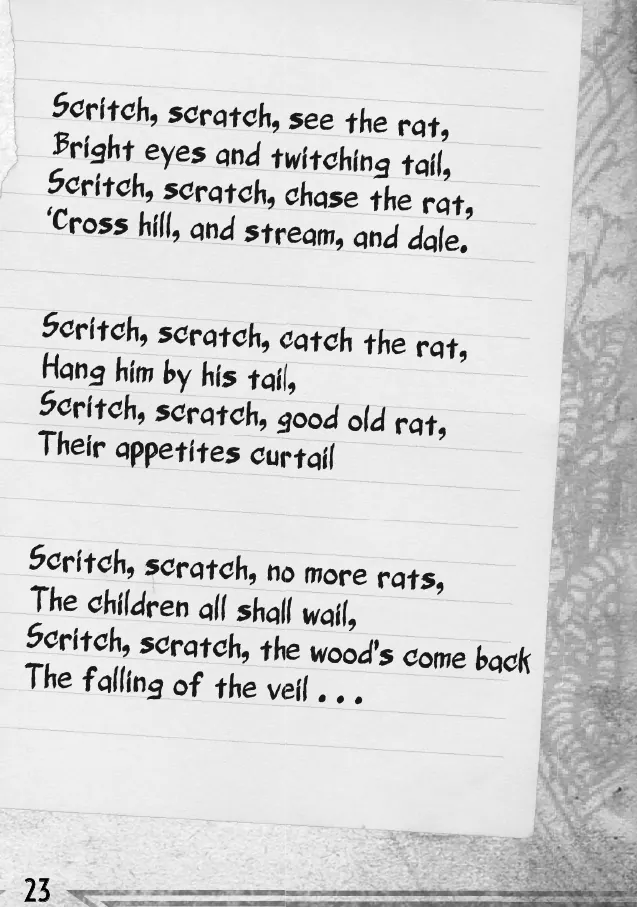

#### Крысиная стая (считается одним существом)

```stat
Хар-ка   Среднее   Бросок
СИЛ      35        (1d6+4) ×5
ВЫН      55        (2d6+4) ×5
ТЕЛ      35        (1d6+4) ×5
ЛВК      70        (4d6) ×5
МОЩ      50        (3d6) ×5

ПЗ: 9
Средний бонус к урону: −1
Средняя Комплекция: −1
Скорость: 9

Бой
Атак за раунд: 1 (зубы или когти).

Натиск (манёвр): стаей крысы могут наброситься и задавить жертву по правилам боевых манёвров, а за счёт своего числа получают при атаке одну бонусную кость. Такая атака означает, что крысы облепляют цель, кусая и царапая её.

Ближний бой         40% (20/8), урон 1d3
Натиск (манёвр)     40% (20/8), урон 2d6
Уклонение           40% (20/8)

Броня: нет.
```

# Приложение B: раздатки для игроков

## Раздатка 1: «Цап-царап»



> **Раздатка 1: «Цап-царап»**
>
> Цап-царап, вот крыса,  
> Глазки блестят, хвостик дрожит,  
> Цап-царап, гони крысу  
> Через холм, ручей и дол.
>
> Цап-царап, лови крысу,  
> Вешай за хвост,  
> Цап-царап, добрая крыса,  
> Их голод уйми.
>
> Цап-царап, нет больше крыс,  
> Дети все заплачут,  
> Цап-царап, лес вернулся —  
> Падает завеса…
