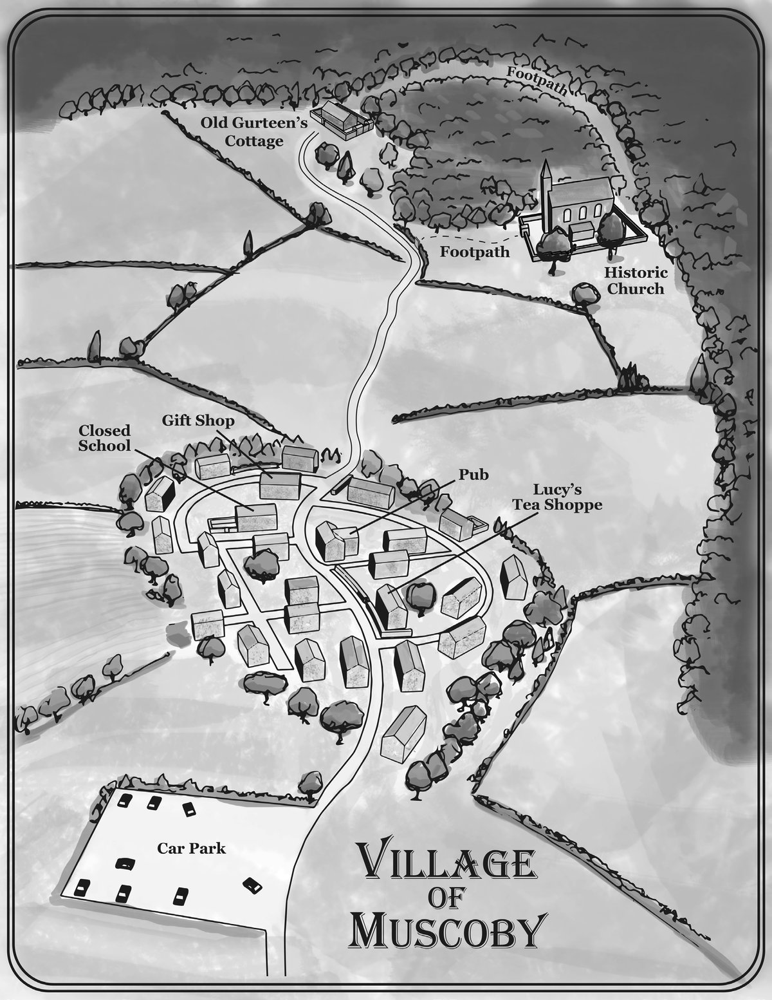

## Раздатка 2: «Маскоби»

> **Раздатка 2: «Маскоби»** — карта деревни Маскоби
>
> Village of Muscoby — Деревня Маскоби; Old Gurteen’s Cottage — Коттедж старого Гуртина; Footpath — Тропа (две: через лес от коттеджа к церкви и к церкви); Historic Church — Историческая церковь (церковь Святой Гертруды); Closed School — Закрытая школа; Gift Shop — Сувенирная лавка; Pub — Паб («Герб крысолова»); Lucy’s Tea Shoppe — Чайная Люси; Car Park — Стоянка.
