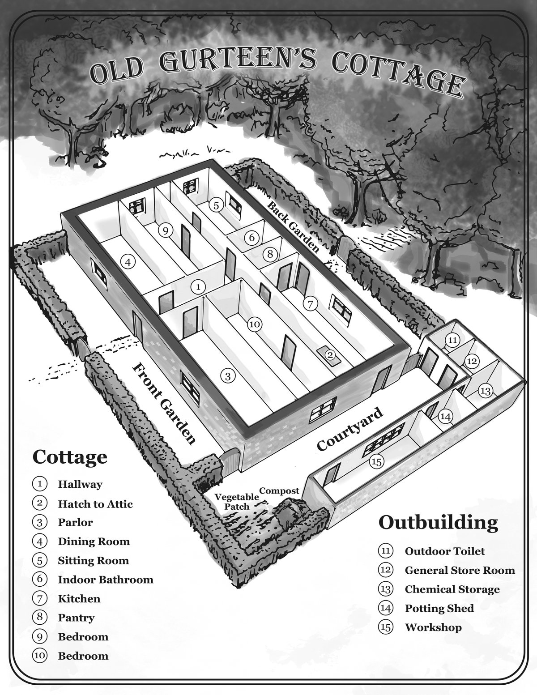

## Раздатка 3: «Коттедж»

> **Раздатка 3: «Коттедж»** — план коттеджа старого Гуртина (Old Gurteen’s Cottage)
>
> **Коттедж (Cottage)**: 1 — прихожая; 2 — люк на чердак; 3 — гостиная; 4 — столовая; 5 — общая комната; 6 — ванная; 7 — кухня; 8 — кладовая; 9 — спальня; 10 — спальня.
>
> **Хозяйственная постройка (Outbuilding)**: 11 — уличная уборная; 12 — кладовая; 13 — химический склад; 14 — сарай для рассады; 15 — мастерская.
>
> Прочие подписи: Front Garden — палисадник; Back Garden — сад за домом; Courtyard — двор; Vegetable Patch — огород; Compost — компостная куча.
