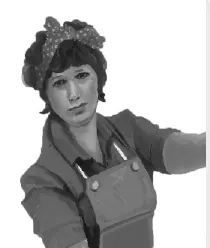

## Лист сыщика: Ширли Мартин



```stat
Имя: Ширли Мартин
Профессия: уборщица (бывшая актриса)
Возраст: 43   Пол: женский

СИЛ 45 (22/9)   ЛВК 70 (35/14)   ИНТ 70 (35/14)
ВЫН 55 (27/11)   НАР 55 (27/11)   МОЩ 40 (20/8)
ТЕЛ 55 (27/11)   ОБР 75 (37/15)
Скорость: 7

ПЗ: 11   Рассудок: 40   Удача: 40   ПМ: 8

Навыки
Ближний бой (драка) 35 (17/7), Внимание 65 (32/13), Вождение автомобиля 20 (10/4), Естествознание 10 (5/2), Запугивание 15 (7/3), Искусство/ремесло (актёрское мастерство) 60 (30/12), История 30 (15/6), Лазание 20 (10/4), Ловкость рук 10 (5/2), Маскировка 40 (20/8), Метание 20 (10/4), Механика 10 (5/2), Наука (биология) 20 (10/4), Наука (химия) 25 (12/5), Обаяние 55 (27/11), Ориентирование 10 (5/2), Первая помощь 30 (15/6), Плавание 20 (10/4), Прыжки 20 (10/4), Психология 65 (32/13), Работа в библиотеке 20 (10/4), Родной язык (английский) 75 (37/15), Скрытность 20 (10/4), Слух 65 (32/13), Средства 25 (12/5), Стрельба (винтовка/дробовик) 25 (12/5), Стрельба (пистолет) 20 (10/4), Убеждение 65 (32/13), Уклонение 35 (17/7), Чтение следов 10 (5/2).

Оружие
Без оружия: обычный успех 35, трудный 17, чрезвычайный 7; урон 1d3 + БкУ; дальность —; атак 1; боезапас —; осечка —

Бой: бонус к урону нет; Комплекция 0; Уклонение 35 (17/7)
```
