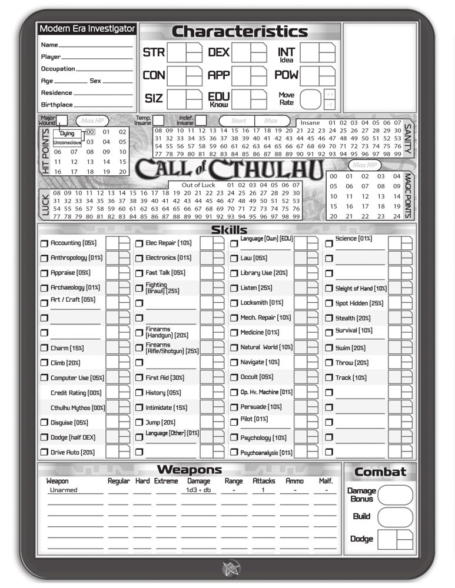

## Чистый лист сыщика: лицевая сторона

*Бланк «Сыщик наших дней» (Modern Era Investigator) для создания новых сыщиков. Поля бланка в переводе:*

- **Сыщик наших дней**: имя, игрок, профессия, возраст, пол, место жительства, место рождения; место для портрета.
- **Характеристики**: СИЛ, ЛВК, ИНТ (Идея), ВЫН, НАР, МОЩ, ТЕЛ, ОБР (Знания) — каждая с половиной и пятой частью; Скорость (с пометками +1/−1).
- **Пункты здоровья**: серьёзная рана; при смерти; без сознания; шкала 00–20.
- **Рассудок**: временное безумие, бессрочное безумие, начальный и максимальный Рассудок; шкала «Безумие» 00–99.
- **Удача**: «Удача кончилась» (Out of Luck); шкала 00–99.
- **Пункты магии**: шкала 00–24.
- **Навыки** (в скобках — базовое значение): Бухгалтерское дело (05%), Антропология (01%), Оценка (05%), Археология (01%), Искусство/ремесло (05%), Обаяние (15%), Лазание (20%), Работа с компьютером (05%), Средства (00%), Мифы Ктулху (00%), Маскировка (05%), Уклонение (½ ЛВК), Вождение автомобиля (20%), Электрика (10%), Электроника (01%), Красноречие (05%), Ближний бой (драка) (25%), Стрельба (пистолет) (20%), Стрельба (винтовка/дробовик) (25%), Первая помощь (30%), История (05%), Запугивание (15%), Прыжки (20%), Иностранный язык (01%), Родной язык (ОБР), Юриспруденция (05%), Работа в библиотеке (20%), Слух (25%), Взлом (01%), Механика (10%), Медицина (01%), Естествознание (10%), Ориентирование (10%), Оккультизм (05%), Управление тяжёлыми машинами (01%), Убеждение (10%), Пилотирование (01%), Психология (10%), Психоанализ (01%), Наука (01%), Ловкость рук (10%), Внимание (25%), Скрытность (20%), Выживание (10%), Плавание (20%), Метание (20%), Чтение следов (10%); пустые строки для своих навыков.
- **Оружие**: оружие, обычный, трудный и чрезвычайный успех, урон, дальность, атак, боезапас, осечка; первая строка — «Без оружия» (урон 1d3 + БкУ, атак 1).
- **Бой**: бонус к урону, Комплекция, Уклонение.
