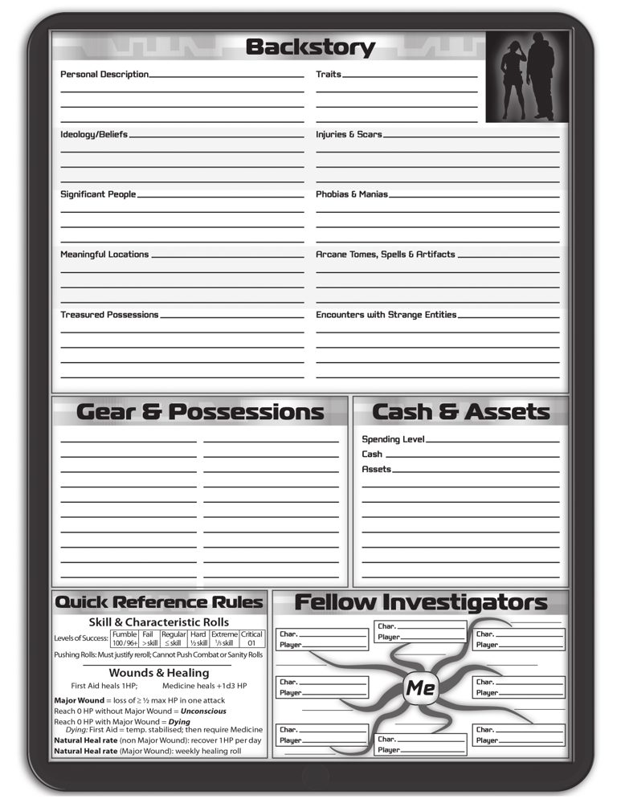

## Чистый лист сыщика: оборот

*Поля оборота в переводе:*

- **Предыстория**: внешность; идеалы и принципы; значимые люди; значимые места; ценные вещи; черты характера; травмы и шрамы; фобии и мании; тайные книги, заклинания и артефакты; встречи с неведомыми существами.
- **Снаряжение и имущество** — пустые строки.
- **Наличность и имущество**: уровень расходов, наличные, имущество.
- **Памятка правил** — та же, что на обороте листа Пола Мартина (степени успеха, повторная проверка, раны и лечение).
- **Другие сыщики** — схема вокруг «Я» с полями «Персонаж» и «Игрок».
