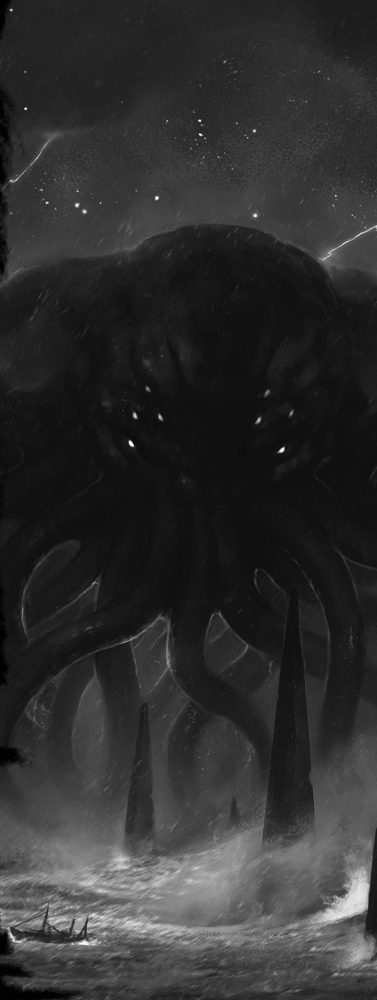

# «Зов Ктулху»

*Реклама на последней странице книги.*

**Ролевая игра ужасов в мирах Г. Ф. Лавкрафта**

Древние правили Землёй за многие эпохи до появления человека. Следы их циклопических городов всё ещё можно найти на далёких островах, под зыбучими песками пустынь и в ледяных пустошах у полюсов. Изначально они пришли в этот мир со звёзд. Теперь они спят — одни глубоко под землёй, другие под морем. Когда звёзды встанут как надо, они снова будут ходить по земле.

«Зов Ктулху» — настольная ролевая игра по мирам Г. Ф. Лавкрафта. Это игра о тайнах, загадках и ужасе. В роли стойких сыщиков вы отправляетесь в странные и опасные места, раскрываете гнусные заговоры и противостоите ужасам Мифов Ктулху. Вы встретите сущности, сокрушающие рассудок, чудовищ и безумных культистов. В странных и забытых томах вы найдёте откровения, которых человеку знать не положено.

Вполне возможно, что именно вы и ваши товарищи решите судьбу мира.

Спрашивайте «Книгу хранителя» и «Книгу сыщика» «Зова Ктулху» в вашем ближайшем магазине настольных игр.

