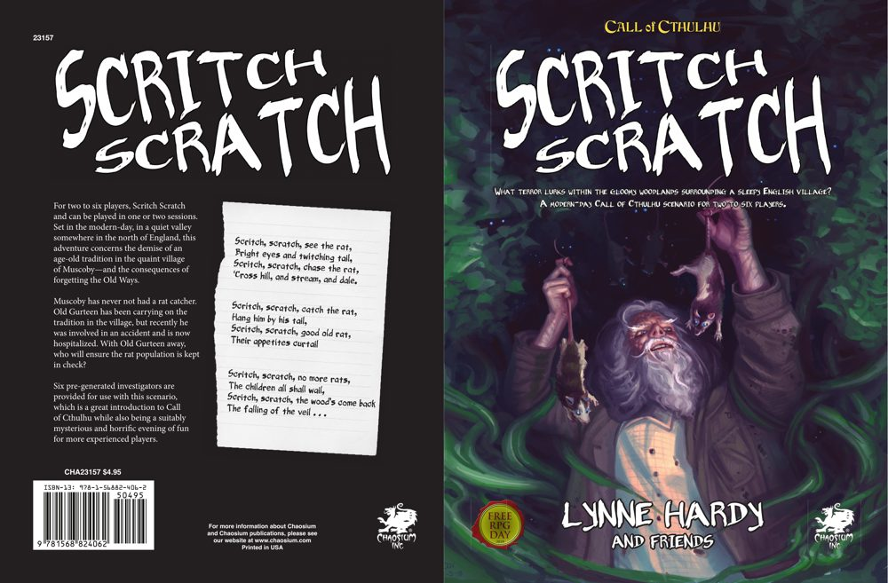

# Задняя обложка

**Цап-царап**

«Цап-царап» — сценарий для двух–шести игроков, который проходится за одну-две сессии. Действие происходит в наши дни, в тихой долине где-то на севере Англии; речь в нём идёт о конце древней традиции в живописной деревне Маскоби — и о том, чем оборачивается забвение Старых обычаев.

В Маскоби никогда не обходились без крысолова. Старый Гуртин продолжал эту традицию в деревне, но недавно попал в аварию и теперь лежит в больнице. Кто же, пока старого Гуртина нет, будет держать в узде крысиное племя?

К сценарию приложены шесть готовых сыщиков; он отлично подходит для знакомства с «Зовом Ктулху» и в то же время подарит опытным игрокам вечер загадочного и жуткого веселья.

*Посередине задней обложки — раздатка 1, стишок «Цап-царап» на листке из тетради (перевод — в приложении B).*

CHA23157 · $4.95 · ISBN 978-1-56882-406-2

Подробнее о Chaosium и его изданиях — на сайте www.chaosium.com. Напечатано в США.

*Прим. перев.: в оригинале задней обложки — «For two to six players, Scritch Scratch and can be played…» (лишнее «and»). Число сессий здесь — одна-две, а во вступлении (с. 4) — одна.*
