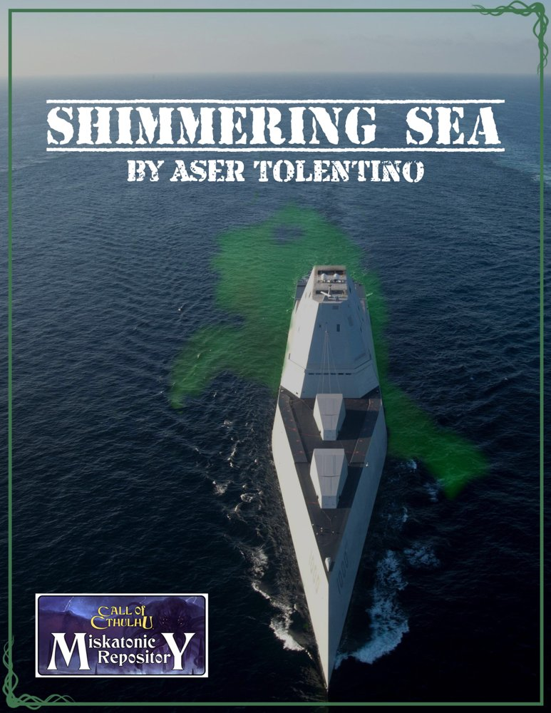

МЕРЦАЮЩЕЕ МОРЕ

Асер Толентино

*На обложке — эсминец-невидимка типа «Замволт» в открытом море, сверху; под ним в воде расплывается зелёное светящееся пятно. Вверху — название «Shimmering Sea» и имя автора (Aser Tolentino), внизу — логотип «Call of Cthulhu — Miskatonic Repository».*
