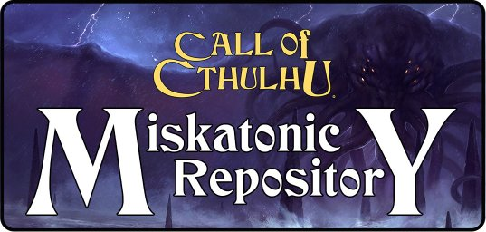

# Выходные данные

| | |
|---|---|
| Ведущий автор и разработчик | Асер Толентино (Aser Tolentino) |
| Дополнительный текст и редактура | Меган Толентино (Megan Tolentino) |
| Иллюстрации | Министерство обороны США, aPinkPanthress, Raul Popadineti, ВМС США, Simon Bray, Marco Monte, 6-й флот США |
| Связь | redactedfilespodcast@gmail.com |
| Сайт | www.theredactedfiles.com |

---

*Call of Cthulhu* («Зов Ктулху») — товарный знак Chaosium Inc., используется с её разрешения по программе OBS Community Content.
Подробнее — на сайте Chaosium: www.chaosium.com

Весь прочий оригинальный материал этой работы © 2019 The Redacted Files и Асер Толентино. Все права защищены. Ни эту книгу, ни какую-либо её часть нельзя воспроизводить или использовать каким бы то ни было образом без письменного разрешения издателя, кроме кратких цитат в рецензии.
