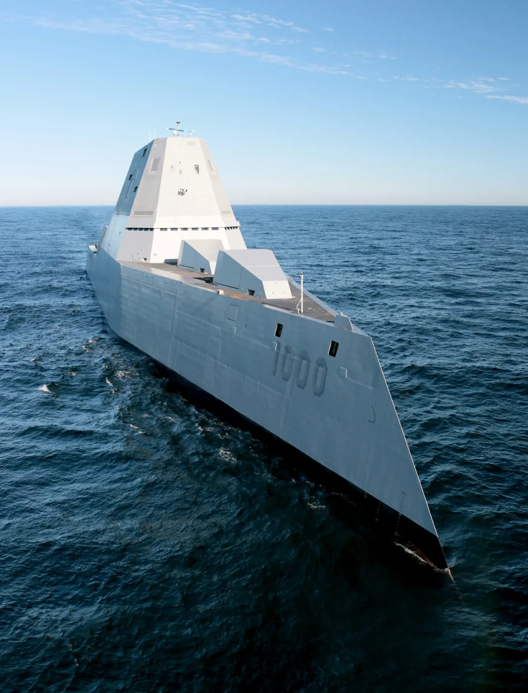

# Вступление

Под искрящимися водами спорного Южно-Китайского моря живут силы, скрытые от глаз смертного человечества и недосягаемые для него, — силы, стоящие вне людских дел. Но время от времени невежественные приматы, мнящие себя хозяевами своего мира, находят какую-нибудь безделушку минувшей эпохи и считают себя достаточно умными, чтобы пустить в ход орудия, способные привлечь внимание существ, куда более древних и могущественных, чем они в силах постичь.

Западная часть Тихого океана балансирует на грани открытой войны. Военно-морские соединения полудюжины стран, включая два авианосца, собрались друг против друга из-за спорных богатств густонаселённой цепи островов. За последнюю неделю напряжение выросло: вблизи китайской боевой группы пропал подводный исследовательский беспилотник ВМС США. Но на борту новейшего корабля флота, эсминца-невидимки типа «Замволт» «Линдон Джонсон», есть другая загадка, которая требует расследования и может обернуться для мира куда более страшными последствиями.

24 августа 2019 года «Линдон Джонсон» вместе с ракетным крейсером «Нормандия» и эсминцами «Берри» и «О’Кейн» вошёл в Южно-Китайское море, чтобы показать флаг и удержать корабли ВМС Народно-освободительной армии Китая от агрессивного патрулирования у островов, на которые претендуют другие члены Ассоциации государств Юго-Восточной Азии.

Через три дня после начала патруля гидроакустик 3-го класса Артур Дункан исчез где-то между 2:30 и 7:30, сменившись со средней вахты. Узнав об исчезновении, вахтенный офицер поднял командира, и корабль обыскали. Не найдя никаких его следов, корабль развернулся, и воды, пройденные с тех пор, как Дункана видели в последний раз, обыскали с помощью корабельного вертолёта SH-60 «Си Хок» и авиации союзных кораблей поблизости. Никаких следов Дункана найти не удалось.

*Прим. перев.: так в оригинале — в хронологии (с. 8) Дункан исчезает 28 августа после средней вахты в 2:00, а хватились его в 7:30; патруль начат 24 августа, и «через три дня» дают 27-е.*

Через два дня главный старшина корабельной полиции Фил Клермонт застрелился из пистолета, взятого в корабельной оружейной. Предсмертной записки он не оставил, и расследование не нашло никаких признаков странного поведения перед самоубийством. Служба криминальных расследований ВМС (NCIS) по указанию председателя Объединённого комитета начальников штабов проявляет к делу повышенный интерес — из-за обстоятельств гибели Клермонта и исчезновения Дункана и из-за секретности технологий на борту «Джонсона», среди которых первый на флоте рельсотрон.

Сыщиков включают в особую рабочую группу, которая должна выяснить, что происходит на «Джонсоне» и есть ли угроза национальной безопасности. Прикомандированные к NCIS, сыщики получат все полномочия, чтобы изучить все стороны исчезновения и гибели и выяснить, есть ли признаки шпионажа, диверсии или преступления. К сожалению, «Джонсон» важен для того, чтобы американские обязательства по безопасности выглядели убедительно, и военная обстановка требует, чтобы корабль оставался в повышенной боевой готовности, пока группа ведёт расследование.

В этом походе «Джонсон» испытывает новую буксируемую гидроакустическую антенну и магнитометр. Именно часть этой системы — источник несчастий «Джонсона». Установленная автономным блоком, который передаёт обработанную телеметрию боевым системам корабля, революционная система обнаружения на деле вовсе не часть магнитометра или гидролокатора. Это своего рода резонансная томография: она воздействует на искусственно возбуждённые молекулы в корпусах кораблей и подлодок, освещённых её лучом. К несчастью для «Джонсона», узел, создающий излучение для этого луча, действует как маяк для шоггота, подвластного колонии глубоководных поблизости: он нарушает их связь с существом, и оно, вырвавшись на волю, охотится на всё, что встречает в перенаселённых водах Южно-Китайского моря. Именно шоггот уничтожил беспилотник ВМС, а также китайское судно снабжения ВМС НОАК, катер, возивший оружие из Индонезии филиппинским повстанцам, и невезучую вьетнамскую рыбацкую лодку.

Пытаясь вернуть власть над шогготом, глубоководные усилили сигнал, которым его призывают. Этот сигнал улавливает антенна «Джонсона», а компьютеры корабля услужливо переводят его в форму, понятную Дункану и Клермонту, — в зов вернуться в море. Клермонт, страдавший тяжёлой водобоязнью, пережил нервный срыв, не сумев до конца противиться воздействию сигнала.
