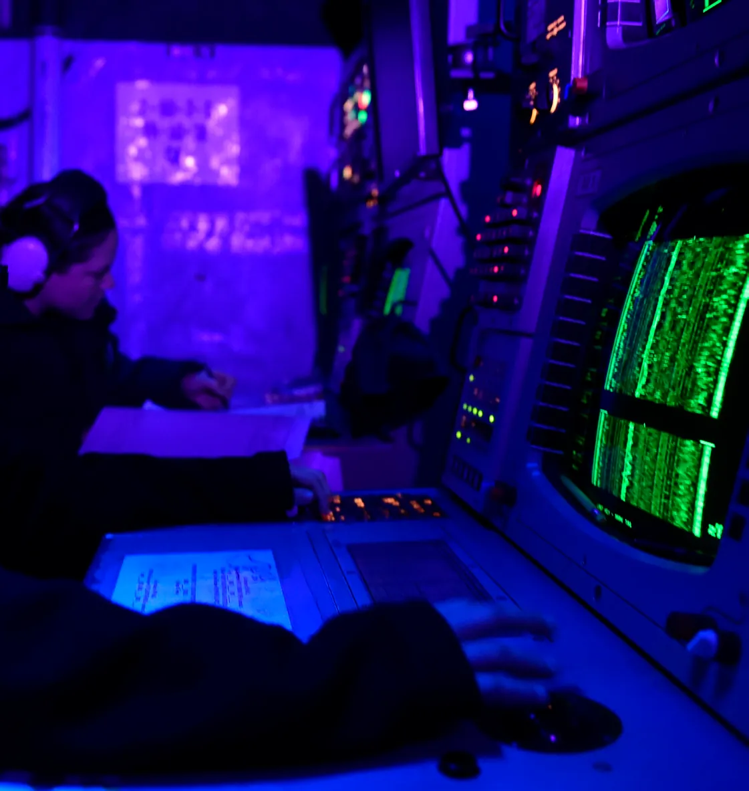

вытесненной водой, отслеживает подлодки и другие крупные металлические объекты по оставленному ими магнитному следу. Сыщики, преуспевшие в проверке Науки (физика), узнают в этом принципе применение эффекта Дебая.

Любой сыщик, преуспевший в проверке Истории или Науки, заметит, что отметки на экранах гидроакустиков отличаются ненормально высокой точностью. Корабль, похоже, почти точно знает местоположение каждой цели — до сотни-другой метров на дальности до 160 километров. Такая точность в высшей степени тревожит и требует проверки Рассудка с потерей 0/1 — из-за революционных возможностей для морской войны.

Двое дежурных гидроакустиков, Деннис Уорнер и Рикардо Гарса, говорят, что Дункан был командным игроком и много трудился, обучая тех, кого ему поручали. Они отзываются о нём с уважением и говорят, что лучше него свою работу на всём корабле знал, пожалуй, только старшина Ааронсон, да и то лишь потому, что тот на этой должности почти двадцать лет. Они могут направить сыщиков к лучшему другу Дункана на корабле — старшине-оружейнику 2-го класса Тодду Фуллеру.

### Каюта Дункана

Каюта Дункана — жилое помещение под палубой. С ним жили ещё трое — оружейники 3-го класса Монсур, Патнаам и Чавес, все из оружейной боевой части. Никто из них не замечал за ним странностей, хотя после того, как на корабль поставили новое оборудование, он, похоже, охотнее проводил время на гидроакустическом посту. Успешная проверка Психологии покажет, что никто из троих не был особенно близок с Дунканом. Они тоже укажут на Тодда Фуллера как на того, кто может знать о нём больше.

Успешная проверка Внимания позволит найти флешку, которую Дункан спрятал в кармане одних из своих спортивных шорт. Содержимое флешки описано ниже, в разделе «Сигнал». Дункан вёл дневник; из него видно, что он работал над головоломкой, которая, как он считал, была ключом к разгадке исчезновения беспилотника. Он полагал, что беспилотник каким-то образом сбил с курса сигнал, который он записал.

### Каюта Клермонта

Старшина корабельной полиции Клермонт делил каюту с двумя другими главными старшинами, которых переселили в другие помещения: он застрелился, сидя за своим столом. Эти двое, Мендоса и Батлер, служат в административной боевой части; они говорят, что он был добросовестным полицейским и держал всё в строгости. Больше о нём, по их словам, мог бы рассказать лейтенант Шеридан, офицер связи и по совместительству юрист корабля.

Успех в трудной проверке Психологии покажет, что Батлер что-то скрывает. Успешная проверка Убеждения уговорит его рассказать сыщикам, что рядом с телом Клермонта на палубе он нашёл бутылку водки. Он убрал бутылку и выбросил её за борт.

Успешная проверка Внимания обнаружит в мусорной корзине Клермонта разорванные руками остатки чего-то похожего на морскую карту. Под столом сыщики могут найти и обломки электронных деталей. Клермонт разбил ноутбук и флешку тяжёлым металлическим предметом — вероятно, стволом пистолета, из которого застрелился.

### Оружейная

Корабельная оружейная — скромное помещение размером со средний кабинет или спальню. В нём стоят стойки с оружием — от пистолетов и винтовок до пулемётов разных калибров. Несколько оружейников обслуживают оружие и возятся с бумагами. Среди них — старшина-оружейник Фуллер.

Фуллер расскажет, что Дункан был на вахте, когда пропал беспилотник, и его напугал странный звук, который, как он клялся, был слышен вдали, но не записался аппаратурой корабля. Успешная проверка Психологии или Убеждения уговорит его рассказать, что Дункан взял данные и прогонял их через собственное оборудование для восстановления звука, пытаясь воссоздать то, что слышал.

В корабельной оружейной есть винтовки M-16, единые пулемёты M-240B и дробовики «Моссберг» M590A1.

### Юридический отдел

Лейтенант (младший) Джеффри Шеридан — серьёзный на вид светловолосый мужчина; он сидит за столом в административной боевой части. После гибели Клермонта он принял расследование исчезновения Дункана. Он явно не справляется и рад передать дело в более опытные руки.
