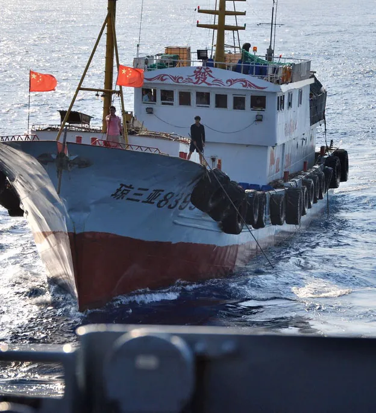

Он скажет, что расследованию помешало то, что Клермонт, похоже, уничтожил бо́льшую часть улик, в том числе ноутбук и рукописные заметки Дункана. Он готов списать всё на два самоубийства, хотя, по его словам, «вся эта история чертовски странная». Он покажет сыщикам пистолет и ноутбук, аккуратно уложенные в пакеты для вещественных доказательств. Чтобы восстановить жёсткий диск ноутбука — извлечь его целым, собрать и поставить в другой компьютер, — нужны проверка Удачи и проверка Электроники со штрафом −40.

### Ангар

В ангаре, куда сыщики прибыли, сейчас стоит вертолёт MH-60R «Си Хок». Под каждым из его коротких крыльев подвешены ракеты «Хеллфайр».

*Прим. перев.: так в оригинале — сыщиков везёт SH-60 «Си Хок», а в ангаре стоит MH-60R.*

### Лодочный отсек

Сыщиков размещают в каютах для приданного отряда сил специальных операций, рядом с лодочным отсеком корабля. Коек здесь хватит на четырнадцать бойцов. Успешная проверка Истории или Антропологии покажет, что это ещё один признак спешки, с которой корабль отправили в поход: он вышел в море без отряда «морских котиков». В самом отсеке стоят две жёсткие надувные лодки, которые спускают на воду по аппарели. Корма корабля открывается, кормовой отсек частично затапливается, и лодки легко выходят в открытое море.

## Китайский траулер

Через несколько часов после начала расследования капитан Пикар вызывает сыщиков на мостик и сообщает, что «Джонсону» приказано остановить китайский траулер, идущий к линии кораблей АСЕАН (Ассоциации государств Юго-Восточной Азии), которые патрулируют к западу от Филиппин. Приказ исходит от Национального командования (на военном жаргоне — от президента) и, вероятно, должен показать решимость Америки. Поскольку Клермонт мёртв, Пикар хочет, чтобы сыщики (чья подготовка больше подходит для такой задачи) отправились на лодках вместе с группой моряков и осмотрели судно: не везёт ли оно грузы или оружие для одного из искусственных островов, построенных Китаем в спорной части Южно-Китайского моря.

Китайское судно идёт с выметанными сетями и ложится в дрейф только после неоднократных приказов остановиться. Сыщикам, возможно, придётся применить Убеждение, чтобы утвердить свою власть над моряками, рвущимися дать предупредительные выстрелы. Капитан судна протестует против высадки, но, когда доходит до дела, подчиняется.

Успешная проверка Психологии подскажет сыщикам, что экипаж нервничает. Открыв для осмотра трюм — в нём рыба, которую можно было бы держать в холоде и получше, — моряки уводят досмотровую группу от частей судна, которые называют жилыми помещениями экипажа. Если сыщики преуспеют в проверке Внимания, они поймут, что трюмы судна какие-то слишком маленькие. Трудный успех проверки Внимания на главной палубе позволит заметить больше обычного радиоантенн, встроенных в надстройку. Успешная проверка Электроники, Истории или Науки позволит опознать в судне корабль радиоэлектронной разведки.

Сыщики, применившие Убеждение к офицерам судна, узнают, что экипажу приказали подойти ближе к американцам и выяснить, нет ли у них связи с американской подлодкой, потопившей накануне китайское судно снабжения. Проверка Идеи напомнит сыщикам, что в их соединении нет американских подлодок. Если надавить, допрашиваемый офицер скажет, что сам видел, как судно затонуло. По его словам, под грузовым судном, выгружавшим строительную технику, появился зелёный свет. Без всякого предупреждения судно вдруг задрало нос, будто село на мель, а потом экипаж услышал страшный треск — по их мнению, это сломался хребет судна. Если сыщики выразят недоверие или получат чрезвычайный успех, офицер рассердится и заявит, что у него есть доказательство. Он достанет телефон и включит запись радиоперехвата, по его словам — от контрабандиста оружия три дня назад. Человек, говорящий на тагальском, отчаянно кричит в эфир, что под водой за его лодкой что-то гонится. Он говорит, что у этого зелёный свет и что, кажется, его нашли американцы. Передача внезапно обрывается звуками разламывающейся лодки.

Если сыщики попытаются задержать судно, капитан будет протестовать, но выполнит любые указания. Когда сыщики вернутся, Пикар придёт в ярость оттого, что теперь он в центре международного инцидента, и обвинит в своём положении сыщиков.
