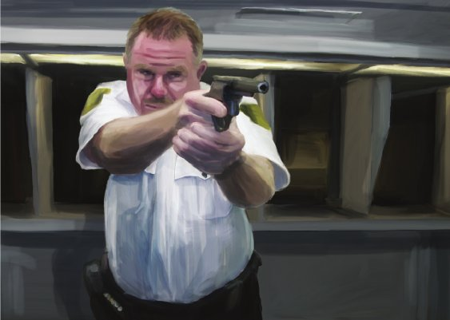
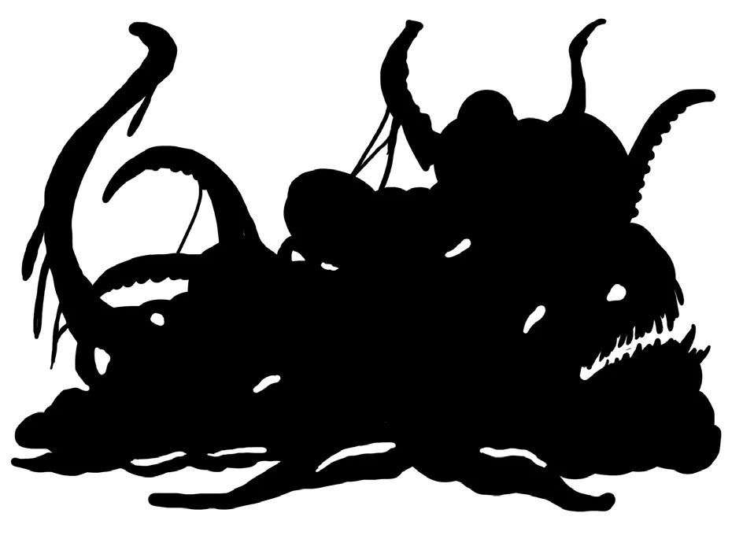

## Пути расследования

### Детектор

Любых сыщиков, которые предложат отключить и/или изучить детектор Дебая, быстро и решительно осаживают старшие офицеры корабля. Капитан Пикар видит в успехе испытаний именно то, что может привлечь к нему внимание влиятельного покровителя. Теперь он думает, что довести корабль до дома с данными испытаний — единственный способ спасти свою карьеру… и своих людей, ведь корабль действует далеко от поддержки, и ему нужно каждое техническое преимущество. Проверка Психологии выявит это, когда разговор заходит на эту тему.

### Сигнал

Чтобы изучить данные на спрятанной флешке или на восстановленном жёстком диске ноутбука и открыть работу Дункана, нужна проверка Работы с компьютером со штрафом −20%. Тот, кто изучает сигнал, восстановленный Дунканом, должен пройти проверку Рассудка 1d4/1d8. Сигнал воспринимается как шёпот на краю сознания, дразняще похожий на голос близкого друга или любимого человека. Голос — если это голос — говорит о том, чтобы вернуться домой, вернуться домой, в море. Сыщики, провалившие проверку Рассудка, должны каждые тридцать минут проходить новую проверку Рассудка: провал не стоит новых очков Рассудка, но сыщик начинает бессознательно двигаться к ближайшему выходу с корабля. Скорее всего, он покинет отсек, где находится, поднимется на главную палубу и подойдёт к лееру, где у него будет последняя возможность пройти проверку Рассудка, прежде чем он прыгнет в море. Любой контакт с другим человеком, заставивший сыщика спросить себя, зачем он идёт к краю палубы, достаточно приведёт его в чувство, чтобы он мог пройти ещё одну проверку Рассудка и сбросить действие сигнала.

### Осмотр детектора

Детектор заключён в запечатанный контейнер длиной 2 метра, шириной и высотой 1 метр; с одного его конца отходит длинный кабель, служащий антенной: её вытравливают за кормой, и на плаву её держит небольшой поплавок. При включении антенна резонирует с двумя маленькими кристаллами — один в поплавке, другой в корпусе. На внутренней стороне сервисного люка детектора надпись «Project Couplet» (проект «Куплет»). Если вынуть один из кристаллов из гнезда, под ним обнаружится бирка «Project Quire, recovered Roswell AFB» (проект «Квайр», найдено на авиабазе Розуэлл).

## Гибель подлодки типа 091

*Прим. перев.: так в оригинале — в хронологии (с. 8) подлодка, которую винят в гибели беспилотника, названа атомной подлодкой типа 093.*

В 23:00 на «Джонсоне» объявляют боевую тревогу. Успешная проверка Идеи подскажет сыщикам, что лучше всего узнать, что происходит, на мостике, в Центре управления кораблём или в запасном Центре управления ближе к корме. Если они придут в одно из этих мест, то увидят, что все присутствующие смотрят на большие экраны, где по данным датчиков строится подводная картина. На ней китайская подлодка — та, которую считают виновной в уничтожении американского беспилотника неделю назад, — стремительно меняет глубину, раз за разом ныряя и поднимаясь. Такое маневрирование было бы для экипажа крайне тяжёлым: людям трудно выдержать перепады давления. В какой-то момент подлодка совершает аварийное всплытие, выскакивая из воды почти целиком, и с грохотом падает обратно. Китайский командир начинает посылать импульсы активного гидролокатора, на несколько мгновений заглушая картину помехами. Потом это прекращается — видимо, он пробует что-то другое — и подлодка выпускает две торпеды в, казалось бы, случайном направлении. Здесь нужна проверка Удачи. Если она провалена, торпеды взводятся и поражают каботажный пароход в нескольких километрах отсюда, на котором двести человек.

Вскоре гидроакустики докладывают, что слышат, как гнётся металл. Прочный корпус подлодки лопается — звук выводят на громкоговорители. Это звук сминающегося, рвущегося металла, и сыщики теряют Рассудок 1/1d6, понимая, что слышат гибель сотни китайских моряков. Капитан Пикар приказывает поднять корабельный вертолёт на поиски выживших.

