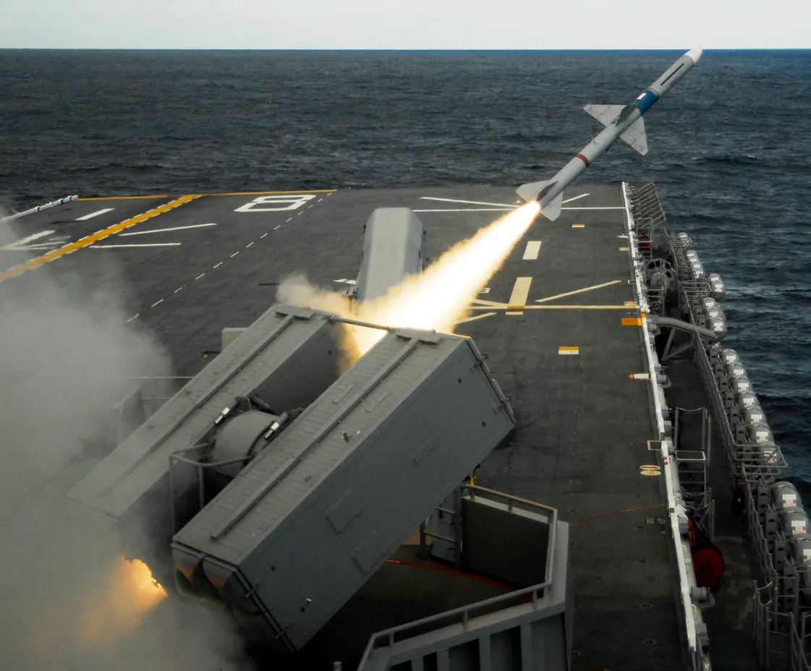

## Кто-то на корпусе

В 23:55 по кораблю снова звучит тревога: вахтенный докладывает о движении у кормы. Ходить по верхней палубе «Джонсона» — опасный атлетический трюк: она не плоская, её высота и наклон резко меняются. Сыщики должны проходить трудную проверку ЛВК каждый раунд, когда они не стоят на месте, отдавая бо́льшую часть внимания удержанию равновесия. Большинство моряков, выходя на палубу, пристёгиваются страховочным тросом. Трос, закреплённый за леерную стойку, не даст сыщику упасть за борт. Если кто-то помогает, держа трос руками, проверки равновесия не нужны. При провале проверки ЛВК персонаж падает и начинает скользить к краю корпуса. Три провала подряд отправляют сыщика за борт, откуда его выловит экипаж, когда палуба будет в безопасности. Успех во время скольжения позволяет пройти ещё одну проверку ЛВК, чтобы встать.

На корме корабля сыщики заметят фигуру, которая пытается пробраться к лебёдке, выбирающей буксируемую антенну детектора Дебая. Между фигурой и сыщиками стоят четверо глубоководных.

У сыщиков пять ходов, чтобы победить глубоководных и остановить детектор Дебая. Если не успеют, появится шоггот. Глубоководные, стоящие между сыщиками и кормой, хотят перебить экипаж корабля за то, что тот принёс устройство в их владения. Пятый глубоководный — то, что осталось от Артура Дункана. Он не хочет видеть, как гибнут его товарищи, и пытается отключить датчик, никому не навредив. Если он успеет всё объяснить, сыщики могут попытаться уговорить Пикара (трудная проверка Убеждения) отключить детектор. Если им это удастся, шоггот показывается за кормой, поднимается из воды, вызывая у сыщиков положенную потерю Рассудка, но затем уходит обратно в глубину. Если детектор не отключён за пять раундов, шоггот нападает на корабль, что бы сыщики ни делали.

## Последний бой

Экипаж «Джонсона» совершенно не готов к такой угрозе. Сыщикам нужно будет самим управлять оружием корабля или с помощью Убеждения или Психоанализа заставить экипаж действовать по выучке. Чтобы заставить экипаж стрелять, сыщики могут применить Убеждение или Психоанализ со штрафом −30%. Они могут также применить Работу с компьютером с половиной навыка, чтобы самим попытаться управлять компьютерными системами оружия. Иначе им придётся применить навык Артиллерии, чтобы напрямую управлять главным оружием, или Стрельбу (тяжёлое оружие), чтобы встать к оборонительным 25-мм пушкам корабля. Ещё один вариант — Убеждением вернуть «Си Хок», чтобы тот применил свои ракеты «Хеллфайр».

Для обороны корабля доступно следующее оружие:

- 1 рельсотрон: перезарядка 1 боевой раунд, урон 10d10, радиус 3 метра;
- 1 155-мм главное орудие: перезарядка 3 раунда, урон 10d10, радиус 5 метров;
- 30 ячеек установки вертикального пуска, по четыре зенитные ракеты ESSM («Эволвд Си Спарроу») в каждой: урон 3d6 (радиус 2 метра);
- 2 ракеты «Хеллфайр»: урон 5d10 (радиус 2 метра).

Первым делом шоггот прикрепится к корпусу и найдёт часть компьютерной сети корабля. Затем он нащупает источник сигналов, наводящих на него оружие, и так определит, где находятся сыщики. После этого он делает четыре проверки МОЩ за ход: сколько проверок успешны, столько атак ему разрешено. Выросший до немыслимых размеров, поглотив несколько судов, он может просовывать части себя поверх корабля, сквозь него и внутри него и атаковать сыщиков в любой точке корпуса.

*Прим. перев.: так в оригинале — в профиле шоггота (с. 9) «Атак за раунд: 2»; в этом бою действует правило текста — четыре проверки МОЩ за ход.*

Если сыщики не сумеют обезвредить шоггота за пять раундов, корпус корабля начнёт разваливаться. Персонажи должны пройти проверку Удачи — не утянет ли их на дно вместе с кораблём — и проверку Уклонения, чтобы шоггот не поглотил их, подбирая уцелевших в воде. Пережить гибель корабля стоит 1/1d6 Рассудка.

Если корабль уцелел, командир (или старший из выживших офицеров) объявляет экипажу запрет на связь. Через час после того, как всё уляжется, прилетает вертолёт с «Карла Винсона» с несколькими высокопоставленными офицерами на борту. Корабль под конвоем уводят из района в Пёрл-Харбор на Гавайях, где всех выживших держат под охраной и допрашивают о возможном китайском химическом или биологическом веществе, которое, судя по всему, вызвало у экипажа массовые галлюцинации. Выжившим, в том числе сыщикам, приказывают никогда и ни при каких обстоятельствах ни с кем не обсуждать события той ночи.

Если корабль затонул, происходит то же самое, только вертолёт — поисково-спасательный конвертоплан V-22: он подбирает выживших членов экипажа (1d20) вместе с сыщиками и доставляет их на «Карл Винсон», где их держат под охраной в лазарете, пока идёт тот же опрос.

