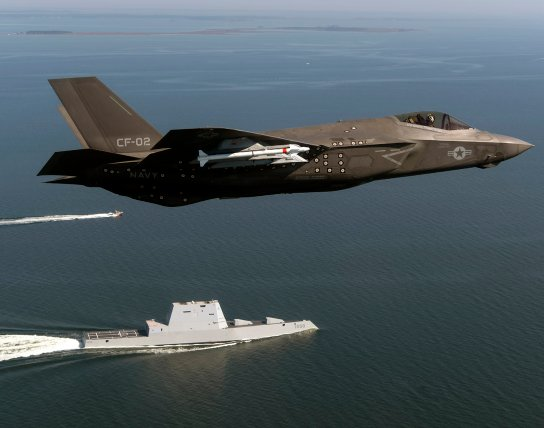

# Хронология

## 20–23 августа 2019 года

Корабли ВМС Народно-освободительной армии Китая начинают высаживать войска на искусственные острова Южно-Китайского моря и ставить там береговые противокорабельные и зенитные комплексы, способные угрожать местным морским путям. Объявленная цель — защитить китайскую торговлю от исламистских групп, которые атакуют местное судоходство дронами-бомбами. «Карл Винсон» только что вернулся из похода в Жёлтое море, и самая боеготовая часть из имеющихся — новейший эсминец Тихоокеанского флота «Линдон Джонсон». Корабль только что закончил подготовку и шёл в Японском море, когда его вместе со всеми кораблями, какие удалось собрать, послали в район.

## 24 августа 2019 года

«Линдон Джонсон» входит в Южно-Китайское море вместе с «Нормандией», «Берри» и «О’Кейном». Он присоединяется к кораблям ВМС Австралии, Новой Зеландии, Вьетнама и Китайской Республики, противостоящим соединению ВМС НОАК, которое выросло до дюжины с лишним кораблей.

## 25 августа 2019 года

**23:45.** Подводный исследовательский аппарат «Мори» с корабля «Боудич» пропал в 1:48, картируя морское дно у островов Спратли. Перед тем как авария вывела из строя его датчики, «Джонсон» засёк под водой цель, достоверно опознанную как атомная подлодка типа 093. Вашингтон обвинил ВМС НОАК в уничтожении беспилотника. В ответ президент Соединённых Штатов приказал выдвинуть ударную группу «Карла Винсона».

*Прим. перев.: так в оригинале — у записи два времени: 23:45 в заголовке и 1:48 в тексте.*

## 28 августа 2019 года

**Утро.** Гидроакустик 3-го класса Артур Дункан исчезает после средней вахты в 2:00. Его отсутствие замечают только в 7:30. Начинаются поиски, а затем расследование.

**2:10.** Катер с лёгким оружием, боеприпасами и взрывчаткой для сепаратистов ИФОМ на юге Филиппин гибнет, столкнувшись с неопознанным объектом. Китайская радиоразведка перехватывает отчаянный вызов, предупреждающий товарищей об американской подлодке со странными зелёными огнями.

## 30 августа 2019 года

**2:00.** Моряк, ответственный за расследование исчезновения гидроакустика Дункана, главный старшина корабельной полиции Клермонт, уничтожает материалы, собранные в каюте Дункана, и стреляет в себя за своим столом.

**2:20.** Китайское судно снабжения гибнет со сломанным хребтом на глазах у гарнизона острова Тритон. Опасаются, что американцы или кто-то из их союзников только что испытал новое оружие, но решают молчать и посмотреть, что известный своими утечками американский Белый дом сам, без давления извне, сообщит «Нью-Йорк таймс».

## 31 августа 2019 года

**16:00.** Сыщики прибывают на авианосец «Карл Винсон» на самолёте палубной доставки C-2 «Грейхаунд». Они сразу садятся в вертолёт SH-60 «Си Хок», летящий на «Джонсон».

**17:30.** Китайские истребители перехватывают и фотографируют «Си Хок» с сыщиками.

**18:00.** Вертолёт SH-60 доставляет следователей NCIS на «Джонсон».

**19:30.** «Джонсон» проводит досмотровую операцию на китайском рыболовном траулере. Сыщики участвуют. Операция занимает около трёх часов.

**23:00.** «Джонсон» объявляет боевую тревогу: гидроакустики засекли, что китайская подлодка начала агрессивно маневрировать. Корабли по всему Южно-Китайскому морю занимают места по боевому расписанию и видят, как подлодка гибнет при загадочных обстоятельствах.

**23:55.** Артур Дункан пытается добраться до буксируемой гидроакустической антенны, чтобы отключить детектор Дебая.

## 1 сентября 2019 года

**24:00.** Шоггот нападает на «Джонсон».

