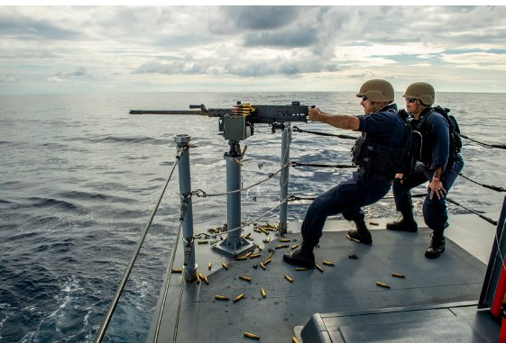

# Готовые сыщики

## Капитан 3-го ранга Джиллиан Моррис

Джиллиан Моррис — кадровый инженер-офицер ВМС США, прикомандированная к NCIS, чтобы обеспечить техническую экспертизу в крайне деликатном расследовании. Она афроамериканского и латиноамериканского происхождения. Как специалист по радиоэлектронной борьбе, капитан 3-го ранга Моррис ожидает, что ей поручат выяснить, причастны ли китайцы к тому, что случилось с Дунканом и Клермонтом. Она очень опасается, что на её выводы будут давить политически. У неё степень бакалавра Массачусетского технологического института и докторская степень Калифорнийского технологического института по электротехнике и оптике. Её мать работала секретарём, а отец — уборщиком в Лаборатории реактивного движения. Теперь они на пенсии и живут в Аризоне. Она до сих пор отсылает им треть своего жалованья.

## Специальный агент Алехандро Эстрада

За плечами специального агента Эстрады больше десяти лет работы по организованной преступности, и он привык, что ему лгут все. Задача в том, чтобы понять, почему люди считают нужным скрывать правду. Он поступил на флот у себя на родине, в Пуэрто-Рико, — решение, расколовшее семью, где хватало сторонников независимости Пуэрто-Рико. Отслужив четыре года, он на средства по солдатскому биллю (GI Bill) четыре года учился в Университете штата Флорида и с отличием получил диплом психолога. Его приставили к Дюбуа, чтобы он взял на себя часть бумажной работы и поучился у ветерана-следователя вести крупные дела.

## Капитан Уэсли Форсайт

Этот капитан — морпех как с вербовочного плаката: отец, дед, прадед и так далее, вплоть до войны 1812 года, тоже служили в морской пехоте. За плечами Форсайта пять лет охраны сил и контртеррористических операций, и его привлекли, чтобы оценить готовность «Джонсона» — буквально, насколько хорошо корабль защищён от нападения таких людей, как он сам. Он почти уверен, что исключил всех обычных злодеев региона, но всегда есть угрозы, о которых не знаешь. На уговоры и запугивание он реагирует плохо. Версию о том, что к случившемуся на «Джонсоне» причастны тайные операции Китая, придётся проверить, потому что главнокомандующий о ней обязательно спросит, пусть даже на вид она нелепа. Есть надежда, что профессиональное мнение ветерана боёв в Сирии добавит отчёту веса. Форсайт в отличной физической форме, как и подобает бойцу разведки морской пехоты (Force Recon), с суровой внешностью и бритой головой. Он никому не говорил, что собирается сменить пол после окончания этой командировки.

*Прим. перев.: в оригинале о Форсайте говорится в нейтральном «they»; в переводе — грамматически мужской род, как у имени и звания.*

## Доктор Шина Брок

Доктора Брок, ведущего специалиста по морской фауне, попросили помочь в разборе нескольких соперничающих теорий, по которым в Южно-Китайском море могут жить неизвестные науке виды, возможно причастные к событиям, приведшим к исчезновению гидроакустика Дункана. Она приехала из Австралии по обмену в Вашингтонский университет и осталась в Сиэтле заниматься наукой и растить детей с мужем-американцем. Она не знает, кто предложил её кандидатуру для такого задания, ведь она убеждённый скептик в отношении криптозоологии, но вместе с запросом пришли предварительные гранты на несколько её крупнейших исследовательских проектов, так что дарёному коню в зубы она смотреть не собирается.

## Специальный агент Блейн Дюбуа

Специальный агент Дюбуа — самый старший в группе, и намного. Он служака на всю жизнь: двадцать лет на флоте, затем контрразведка в ФБР и, наконец, переход в NCIS. Он сдержанный на вид человек индейского и франкоканадского происхождения. Он чрезвычайно наблюдателен и много лет служил в западной части Тихого океана. Его тщательно отобрали за умение делать дело, не поднимая шума.

## Лейтенант Мэрилин «Твикер» Чан

Лейтенанта Чан вызвали прямо из зала ожидания аэропорта Лос-Анджелеса в начале заслуженного отпуска, чтобы её опыт лётчика и офицера по техническому обслуживанию дополнил эту странную компанию знатоков. О приказах она не спрашивает — просто выполняет их. Она только что прошла ознакомительный курс по беспилотникам и, вероятно, ей придётся несколько недель проверять журналы техобслуживания или ещё чем-нибудь себя занимать. Ростом она чуть ниже среднего; в её родословной три поколения китайских иммигрантов. Технические стороны этого расследования ей по крайней мере интересны, и, чем бы всё ни кончилось, она всегда сможет сказать, что была причастна к «инциденту в Южно-Китайском море».

