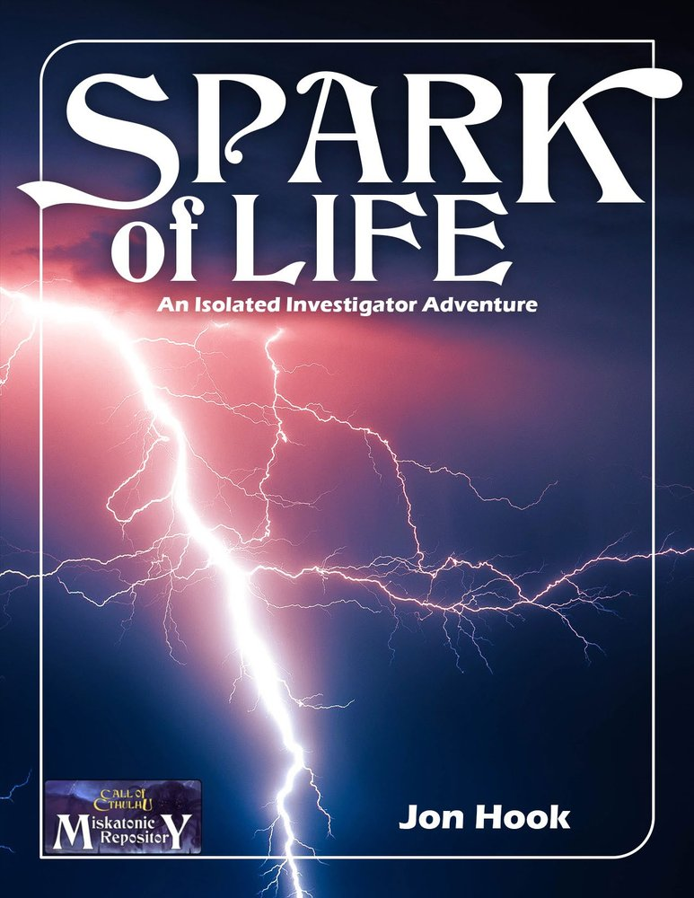

ИСКРА ЖИЗНИ

Приключение для одиночного сыщика

Джон Хук

*На обложке — ветвистая молния на фоне тёмно-синего ночного неба с багровым заревом; вверху — название «Spark of Life» и подзаголовок «An Isolated Investigator Adventure» («Приключение для одиночного сыщика»), внизу — логотип «Call of Cthulhu — Miskatonic Repository» и имя автора (Jon Hook).*
