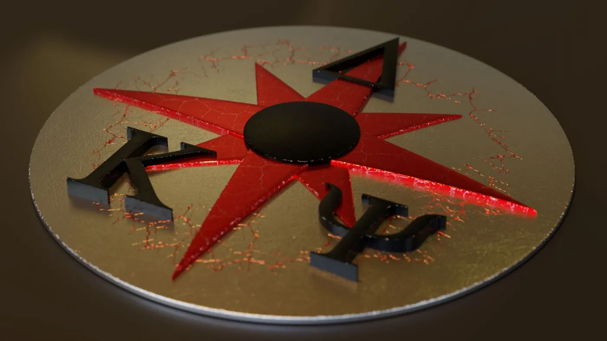

проверку **Уклонения** со **штрафной костью** против **Ближнего боя (драки) 50%** тени. Удалась атака или нет, тень убегает в темноту, но случайно роняет у ног аспиранта маленький предмет — значок кандидата в братство Каппа Дельта Пси (*раздатка «Искра жизни» 1*).

Через несколько мгновений после нападения или после того, как тень убежала, появляется лучший друг аспиранта, Томас Форте. Томас спешит на помощь и предлагает проводить аспиранта до пансиона: Томас снимает комнату в том же доме. Все знают, что дом братства Каппа Дельта Пси стоит на углу Пикман-стрит и Уэст-стрит. Томас подозревает, что нападение было просто неудачным розыгрышем: в кампусе как раз идёт неделя набора в братства. Если аспирант не нашёл значок кандидата, его непременно находит Томас и отдаёт аспиранту.

> ### Распорядок дня
>
> Вот обычный распорядок дня аспиранта, когда он не занят расследованием странностей в своей жизни:
>
> - 6:30 — подъём и сборы;
> - 8:00–11:00 — работа ассистентом и утренние занятия;
> - 12:00–13:00 — обед с Томасом (лучшим другом);
> - 14:00–17:00 — работа ассистентом и дневные занятия;
> - 18:00–19:00 — ужин с Томасом (лучшим другом);
> - с 20:00 и до изнеможения — занятия в библиотеке Орна.

# Странные наблюдения

Вряд ли у аспиранта найдётся достаточно причин, чтобы (пока что) всерьёз взяться за расследование братства Каппа Дельта Пси (КДП). Но скоро поводов присмотреться к КДП станет достаточно.

**Хранителю на заметку.** Время в этом сценарии гибкое. Было бы нереалистично — почти преступная слежка (хотя таких законов в 1920-х ещё не было), — чтобы парни из братства КДП, культисты Ксейруу’ка, каждый час следили за аспирантом, наблюдали за ним и донимали его. Поэтому Хранитель сам решает, когда сдвигать время в этом сценарии. Помните, что сценарий начался в понедельник 6-го; чем ближе к субботе 11-го — дню вечеринки Каппа Дельта Пси в тогах, — тем чаще аспиранта донимают.

По усмотрению Хранителя попросите аспиранта сделать проверку **Внимания**. При успехе аспирант замечает студента, который наблюдает за ним издали. Если аспирант как-то попытается с ним заговорить, наблюдатель (культист Ксейруу’ка) разворачивается и уходит, будто ничего необычного не случилось. Если проверка **Внимания** дала хотя бы **трудный успех**, аспирант замечает на наблюдателе точно такой же значок кандидата КДП, какой нашёл в понедельник вечером.
