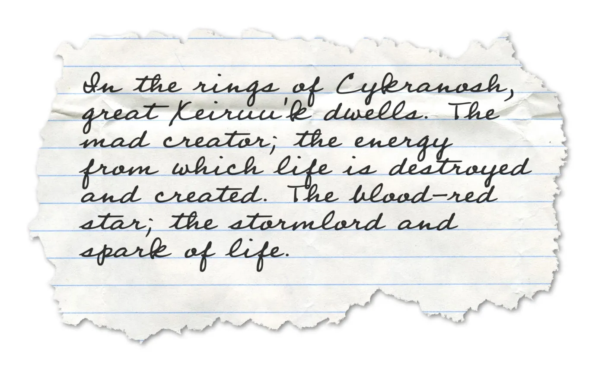

Имя «Ксейруу’к» доктору Армитеджу незнакомо, но он признаёт, что эти странные книги в основном изучал так: читал отдельные главы и бегло пролистывал. Доктор Армитедж очень занят. Он может позволить аспиранту просматривать Закрытое собрание только два часа и только под своим бдительным присмотром. Зато помощь доктора Армитеджа даёт одну **бонусную кость**, а если помогает и Томас — вторую **бонусную кость**.

Если проверка **Работы в библиотеке** в Закрытом собрании удалась, найден следующий отрывок:

- «Невыразимые культы». В этой книге есть единственный отрывок, где упоминается Ксейруу’к: *«В кольцах Цикраноша обитает великий Ксейруу’к. Безумный творец; энергия, из которой жизнь уничтожается и создаётся. Кроваво-красная звезда; повелитель бурь и искра жизни».* Когда отрывок найден, доктор Армитедж переписывает его на клочок бумаги, отдаёт аспиранту, а затем просит его уйти, чтобы заняться другими делами, требующими его внимания. *Раздатка «Искра жизни» 7.*
- Два напряжённых часа над разными оккультными книгами и книгами Мифов меняют человека. Поэтому аспирант теряет **1 пункт Рассудка** и получает **+1%** к навыку **Мифы Ктулху**.

*На клочке линованной бумаги от руки: «В кольцах Цикраноша обитает великий Ксейруу’к. Безумный творец; энергия, из которой жизнь уничтожается и создаётся. Кроваво-красная звезда; повелитель бурь и искра жизни».*

**Хранителю на заметку.** Аспирант может обратиться за помощью к кому-то из старших преподавателей — например, к декану своего факультета (как сделал один игрок на тестовой игре). Преподаватель должен отнестись к тревогам аспиранта с сочувствием: аспирант — образцовый студент, и у него нет причин обманывать преподавателя. Подвох в том, что преподаватель — выпускник Каппа Дельта Пси.

На тестовой игре вышло так: преподаватель был настолько тронут бедой аспиранта, что одолжил ему ключ от собственной рыбацкой хижины в нескольких милях к северу от Аркхэма. Аспирант был очень благодарен за хижину, но преподаватель из КДП (культист Ксейруу’ка) его предал: сообщил братству, где можно найти аспиранта. Хранитель должен дать аспиранту проверку **Внимания**, чтобы заметить маленькую фотографию, на которой преподаватель лет двадцати с небольшим позирует с братьями перед домом братства КДП; чтобы заметить фотографию, аспиранту нужен **трудный успех**.

# Вечеринка в тогах

Начиная со среды, 8 сентября, весь кампус обклеен листовками, зазывающими на ежегодную вечеринку Каппа Дельта Пси в тогах в субботу, 11 сентября. Листовок столько, что аспирант узнаёт о предстоящей вечеринке без всякой проверки навыков.

Если аспирант поговорит с Томасом о вечеринке в тогах, Томас скажет, что, по его мнению, в братстве Каппа Дельта Пси творится что-то странное, только он не понимает, что именно и почему братство так увлечено аспирантом (если не считать совпадения с его особой приметой). Томас считает, что если у братства и есть какие-то тайны, найти их можно только в его доме. Иначе к той же догадке — все тайны братства спрятаны в доме братства — аспиранта приводит успешная проверка **Идеи**.

Аспирант может попытаться обыскать дом Каппа Дельта Пси либо до вечеринки, либо во время неё.

**До вечеринки.** Успешная проверка **Идеи** подсказывает аспиранту, что в обычный учебный день в доме братства вряд ли окажется много парней из Каппа Дельта Пси: у них занятия. Народу в доме братства куда больше по вечерам и в выходные.

Если аспирант днём подойдёт к дому братства и постучит в дверь, он может сделать проверку **Удачи**. При провале дверь открывает кто-то из жильцов дома. При успехе дверь никто не открывает. Ни двери, ни окна не заперты.

> ### Днём в доме КДП
>
> Днём в доме может быть сколько угодно братьев — много или мало, на усмотрение Хранителя. Если аспирант стучал в дверь, проверка **Удачи** при стуке определяет только, откроют ли дверь, а не то, есть ли кто-нибудь дома.
>
> Все члены братства Каппа Дельта Пси — культисты на службе Ксейруу’ка, и все они узнают аспиранта в лицо. У культистов есть план заманить аспиранта в дом в ночь вечеринки в тогах, поэтому до вечеринки вредить ему они не хотят. Если аспиранта застанут в доме братства до вечеринки в тогах, культисты только постараются не дать ему унести собственность КДП.
>
> Хранитель может просить аспиранта делать новую проверку **Удачи** при входе в каждую комнату или сам решить, в каких местах есть культисты. В остальном Хранитель может описывать каждую комнату дома братства так, как она описана ниже.
