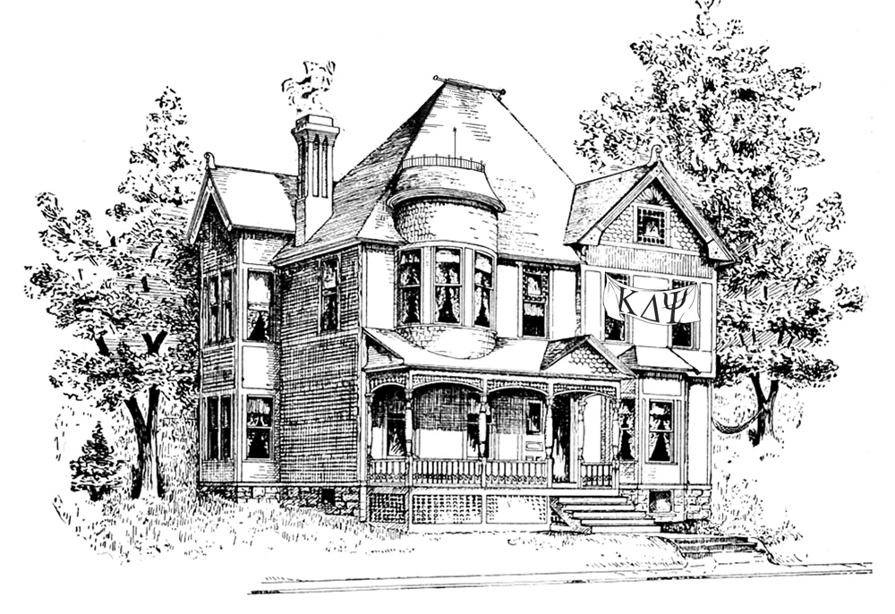

## Дом братства Каппа Дельта Пси

### Комнаты первого этажа

**Веранда.** Крытое крыльцо у входа, чистое и приветливое.

**Холлы.** Стены холлов увешаны ежегодными фотографиями выпусков. Табличка над входом в вестибюль гласит по-латыни: *«Per Positivum Mutatio Magicae»*. Успешная проверка навыка **Иностранный язык (латынь)** переводит надпись: «Позитивные перемены через магию».

**Гостиная.** Здесь изящные кресла из ореха и кожи, небольшой письменный стол, напольный радиоприёмник, граммофон и целая стена книжных шкафов. При успешной проверке **Внимания** аспирант находит несколько книг по астрономии о планете Сатурн. Странно найти в доме братства хоть одну книгу по астрономии — не то что пять.

**Малая гостиная.** Здесь кабинетный рояль и несколько кушеток.

**Столовая.** Большой дубовый стол с двумя длинными скамьями по сторонам. По торцам стола стоят изящные кресла. Шёлковая дорожка на столе расшита греческими буквами братства и его звездой.

**Кухня и кладовая.** Продуктов в них в избытке, кухонная утварь исправна.

**Задняя веранда.** Крытое крыльцо, чистое и приветливое. В углу стоит пустая бочка из-под виски, в ней несколько садовых инструментов на длинных черенках (мётлы, мотыги и грабли).

**Боковое крыльцо.** Маленькое крытое крыльцо ведёт прямо на кухню.

> ### Звезда братства Каппа Дельта Пси
>
> Вместо герба или щита братство КДП обозначает себя особой звездой со своими греческими буквами. Звезда братства — чёрный круг в центре и восемь расходящихся от него розовых лучей. Лучи звезды обычно (но не всегда) изображают с электрическими искрами, как на значке кандидата КДП. Большинство думает, что это стилизованная роза ветров, но на самом деле это стилизованное изображение самого Ксейруу’ка.

### Комнаты второго этажа

**Холл.** Стены этого холла увешаны портретами прежних президентов Каппа Дельта Пси, а в конце холла, прямо у покоев президента, висит большой портрет Корнелиуса Вестингауза маслом.

**Покои президента.** В этой большой спальне сейчас живёт Кевин Дж. Честерфилд III. У эркера стоит железная лестница, привинченная к деревянному полу. Лестница ведёт к люку в потолке. Люк ведёт наверх, на площадку Вестингауза. При обыске этой комнаты успешная проверка **Внимания** находит в гардеробной коробку из-под обуви, а в ней — револьвер .38 «Смит-и-Вессон» и коробку с двадцатью патронами. На небольшом письменном столе в углу комнаты разложена дюжина фотографий: это
